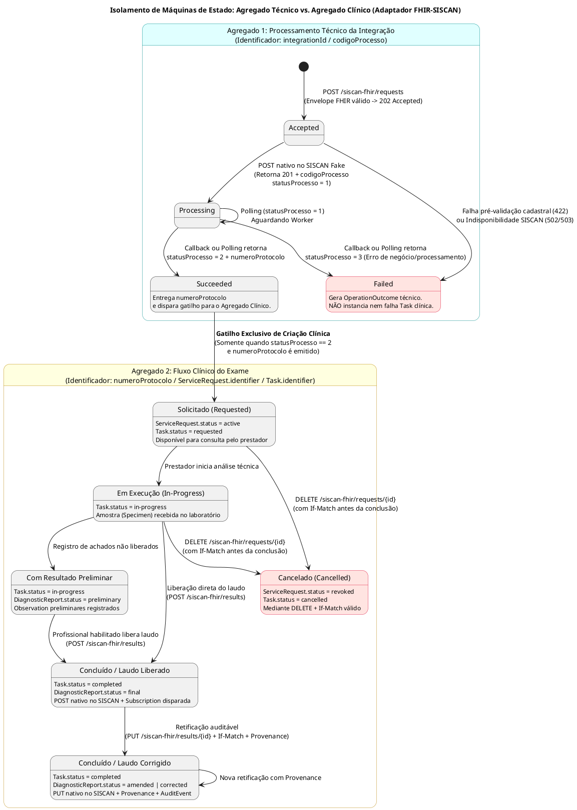

# Especificação Arquitetural e de Design de Software (SDD)
## Frente 2: Adaptador de Interoperabilidade FHIR-SISCAN e Simulador Contratual da API SISCAN

---

## 1. Visão Geral, Escopo e Decisões Arquiteturais (ADR)

### 1.1. Propósito e Escopo
O objetivo desta frente é viabilizar a interoperabilidade da jornada de rastreamento e investigação do **câncer do colo do útero** (exames citopatológicos e histopatológicos) entre sistemas clínicos heterogêneos (PEPs) que operam em **HL7 FHIR R4 (v4.0.1)** e o **Sistema de Informação do Câncer (SISCAN)** do DATASUS, que opera sob um contrato **REST/JSON nativo** e assíncrono. Todo o tráfego utiliza exclusivamente dados sintéticos.

### 1.2. Registro de Decisão Arquitetural (ADR-001: Padrão Camada Anticorrupção e Simulador Contratual)
* **Contexto:** O SISCAN possui semântica legada própria, autenticação via Keycloak (`client_credentials`), processamento assíncrono baseado em `codigoProcesso`/`numeroProtocolo` e conceitos acoplados à interface gráfica (como "destravamento de laudo" e "ícone de lupa"). Além disso, há divergência entre o Manual de Integração v3.0 (que prevê HTTP `404` e `422`) e os arquivos OpenAPI 3.0 v1.0 de homologação (que declaram `400`, `401`, `403` e `500`).
* **Alternativa Rejeitada:** *Integração Direta / Pass-through no PEP ou criação de API inventada a partir das telas do SISCAN*. Foi rejeitada porque acoplaria os sistemas clientes ao formato proprietário do DATASUS, espalharia regras de negócio e credenciais do Keycloak pelos prontuários e impediria a evolução padronizada em FHIR R4.
* **Decisão:** Implementar o **Adaptador FHIR-SISCAN** atuando como **Camada Anticorrupção (ACL)** interna à plataforma e construir o **SISCAN Fake** como um **Simulador Contratual Estrito** (sistema externo no modelo C4) baseado em uma cópia versionada e fixada dos contratos OpenAPI e do Manual v3.0.
* **Consequências:** Isolamento completo do domínio FHIR R4; abstração dos conceitos de tela do legado para versionamento explícito de recursos (`DiagnosticReport` + `Provenance`); e separação rigorosa entre falhas técnicas de rede/contrato e o ciclo de vida clínico do exame.

---

## 2. Especificação Técnica dos Componentes

### 2.1. Simulador Contratual da API SISCAN (SISCAN Fake)
Classificado como **Sistema de Software Externo** no Modelo C4, o simulador é acessado exclusivamente pelo Adaptador FHIR-SISCAN e preserva rigorosamente nomes, tipos, obrigatoriedade e cardinalidade dos DTOs oficiais.

* **Segurança Emulada (Mock Keycloak):**
  * Rota: `POST /realms/portal-servicos/protocol/openid-connect/token` (`Content-Type: application/x-www-form-urlencoded`, `grant_type=client_credentials`, `client_id`, `client_secret`).
  * Emite JWT sintético exigido no header `Authorization: Bearer <token>` em todas as operações subsequentes. Segredos e tokens jamais são gravados em logs.
* **Superfície REST de Escrita (Swagger 1):**
  * Requisições: `POST`, `PUT /{protocolo}` e `DELETE /{protocolo}` em `/api/v1/requisicao-exame/citopatologico-colo-utero` e `/api/v1/requisicao-exame/histopatologico-colo-utero`.
  * Resultados (Laudos): `POST`, `PUT /{protocolo}` e `DELETE /{protocolo}` em `/api/v1/resultado-exame/citopatologico-colo-utero` e `/api/v1/resultado-exame/histopatologico-colo-utero`.
  * Retorno de Criação (`POST`): HTTP `201 Created` contendo `ResponseCreatedRequisicaoDto` (`success`, `message`, `codigoProcesso`, `data`).
* **Superfície REST de Consulta e Validação Cadastral (Swagger 2):**
  * Status Técnico: `GET /api/v1/processamento/requisicao-exame/{codigo}` retornando `statusProcesso`: `1` (processando), `2` (processado com sucesso + `numeroProtocolo`) ou `3` (processado com erro + descrição da falha).
  * Jornada Clínica: `GET /api/v1/requisicao-exame/{protocolo}` e `GET /api/v1/requisicao-exame/{protocolo}/resultado-exame`.
  * Cadastros e Vínculos: `GET /api/v1/estabelecimento-saude/{cnes}/profissional/{cns}/cbo/{cbo}` e `GET /api/v1/estabelecimento-saude/vinculo/prestador-servico/citopatologico-colo-utero` (e equivalente histopatológico).
* **Motor Assíncrono (Worker de Callback) e Regras de Domínio:**
  * Se `callBackUrl` for informada na requisição, o worker dispara `POST` assíncrono para a URL HTTPS educacional do adaptador ao concluir o processamento, permitindo injetar atrasos, duplicidades e falhas `500`/`503`.
  * Valida formato de CNS/CNES, habilitação de CBO do profissional (ex.: `2231F8`, `223505`) e vínculo ativo entre `unidadeRequisitante.cnes` e `prestadorServico.cnes`, retornando `400`, `404` ou `422` conforme fixado na cópia contratual. Suporta a coexistência entre a citologia tradicional e o rastreamento primário por teste molecular de DNA-HPV oncogênico.

---

### 2.2. Adaptador de Interoperabilidade FHIR-SISCAN (Tradutor FHIR)
Classificado como **Contêiner** da plataforma, expõe a fachada educacional FHIR R4 (acessada via Gateway de Integração) e gerencia a conciliação assíncrona com o simulador.

#### Contrato da Fachada FHIR R4

| Endpoint da Fachada | Entrada / Saída FHIR R4 | Regras de Negócio, Idempotência e Concorrência |
| :--- | :--- | :--- |
| `POST /siscan-fhir/requests` | **In:** `Bundle` (`ServiceRequest`, `Specimen`, `Patient`, etc.)<br>**Out:** `202 Accepted` + `Location: /siscan-fhir/integrations/{integrationId}` | Exige chave de idempotência (`Idempotency-Key`). Mesma chave + mesmo payload repete a resposta; mesma chave + payload distinto retorna `409 Conflict`. |
| `GET /siscan-fhir/integrations/{integrationId}` | **Out:** Estado técnico (`accepted`, `processing`, `succeeded`, `failed`) + `OperationOutcome` (em falha) | Consulta exclusiva do estado técnico (`codigoProcesso`). Não cria nem expõe `Task` clínica. |
| `GET /siscan-fhir/requests/{serviceRequestId}` | **Out:** `Bundle` (`ServiceRequest`, `Task` clínica e referências) | Devolve o estado clínico reconciliado e o `numeroProtocolo` quando `statusProcesso = 2`. |
| `DELETE /siscan-fhir/requests/{serviceRequestId}` | **Out:** `OperationOutcome` | Cancela a requisição antes de estado clínico terminal; exige `If-Match` (retorna `412 Precondition Failed` se versão divergir). |
| `POST /siscan-fhir/results` | **In:** `Bundle` (`DiagnosticReport`, `Observation` e referências) | Exige chave de idempotência. Envia laudo liberado (`final`) vinculado a um protocolo válido. |
| `PUT /siscan-fhir/results/{diagnosticReportId}` | **In:** Nova versão do `DiagnosticReport` (`amended`/`corrected`) + `Provenance` | Retifica laudo mediante `If-Match`, justificativa clínica e `Provenance`, acionando `PUT` nativo no SISCAN. |
| `GET /siscan-fhir/requests/{serviceRequestId}/result` | **Out:** `Bundle` (`DiagnosticReport` e `Observation`) | Recupera resultado autorizado reconciliado sem alterar seu estado. |

#### Matriz de Mapeamento Semântico e de Estados (`FHIR R4` $\leftrightarrow$ `SISCAN Nativo`)

| Conceito / Atributo no SISCAN | Recurso / Elemento FHIR R4 | Regra de Transformação e Semântica |
| :--- | :--- | :--- |
| Requisição de Exame (`Requisicao...Dto`) | `ServiceRequest` | `ServiceRequest.status = active` quando aceito pelo SISCAN. |
| `codigoProcesso` (Retorno HTTP 201) | Registro interno de Integração (`integrationId`) | Controla apenas o estado técnico (`1` processando, `2` concluído, `3` falhou). **Nunca** identifica a `Task` clínica. |
| `numeroProtocolo` (Gerado no status 2) | `ServiceRequest.identifier` e `Task.identifier` | Atribuído somente após confirmação de `statusProcesso = 2`, iniciando o ciclo clínico. |
| Dados de Coleta (`dadoColeta`) | `Specimen` | Representa o material biológico coletado e a data/hora da coleta. |
| Estado SISCAN: *Requisitado* | `ServiceRequest.status = active` + `Task.status = requested` | Exame registrado com protocolo e aguardando processamento laboratorial. |
| Estado SISCAN: *Em análise no prestador* | `Task.status = in-progress` | Acompanha recebimento da amostra e execução técnica pelo laboratório. |
| Estado SISCAN: *Com resultado (não liberado)* | `DiagnosticReport.status = preliminary` + `Observation` | Resultados preliminares registrados antes da liberação formal. |
| Estado SISCAN: *Laudo liberado* | `DiagnosticReport.status = final` + `Task.status = completed` | Aciona `POST` nativo de resultado no SISCAN e dispara `Subscription` para a unidade solicitante. |
| Estado SISCAN: *Destravamento / Correção* | `DiagnosticReport.status = amended` ou `corrected` + `Provenance` | Abstrai o conceito de tela "destravar"; gera nova versão FHIR e executa `PUT /{protocolo}` no SISCAN. |
| Achados Clínicos (ex.: `lesoesBenignas.tipo`, `procedimentoOCI`) | `Observation.valueCodeableConcept` / `component` | Traduz códigos de domínio do manual v3.0 para sistemas terminológicos validados. |
| Laudo Formatado para Impressão/Leitura | `DiagnosticReport.presentedForm` | Mantém a representação textual/humana do laudo liberado. |
| Rastreabilidade de Acesso e Modificação | `AuditEvent` | Enviado de forma minimizada ao Coletor de Auditoria (LGPD), sem vazar dados clínicos na telemetria. |

---

## 3. Diagramas Arquiteturais em PlantUML

### 3.1. Diagrama de Componentes e Fronteiras (C4 Nível 2/3 - Recorte SISCAN)
Este diagrama detalha a estrutura interna do **Adaptador FHIR-SISCAN** e do **Simulador SISCAN**, bem como suas interações com os demais contêineres da plataforma.

```plantuml
@startuml C4_Recorte_FHIR_SISCAN
!include https://raw.githubusercontent.com/plantuml-stdlib/C4-PlantUML/master/C4_Component.puml

LAYOUT_WITH_LEGEND()
title Arquitetura C4 (Recorte Detalhado) - Adaptador FHIR-SISCAN e Simulador Contratual

System_Ext(pep, "Aplicação Clínica / PEP Simulado", "Solicita exames (ServiceRequest), submete laudos (DiagnosticReport) e recebe notificações.")

System_Boundary(plataforma, "Plataforma Estadual de Interoperabilidade em Saúde") {
    Container(gateway, "Gateway de Integração", "API Gateway", "Autentica clientes, controla rate limit e roteia chamadas FHIR.")
    Container(fhir_server, "Servidor FHIR R4", "FHIR Server", "Persiste ServiceRequest, Task, Specimen, Observation, DiagnosticReport e Provenance.")
    Container(val_term, "Serviço de Validação e Terminologia", "Serviço", "Valida perfis FHIR R4 e resolve terminologias controladas.")
    Container(eventos, "Serviço de Eventos e Subscriptions", "Mensageria", "Detecta mudanças no Servidor FHIR e notifica assinantes.")
    Container(auditoria, "Coletor de Auditoria", "Coletor", "Recebe eventos AuditEvent minimizados.")
    Container(telemetria, "Coletor de Telemetria", "Observabilidade", "Recebe métricas e rastros distribuídos sem dados clínicos.")

    Container_Boundary(acl_siscan, "Adaptador de Interoperabilidade FHIR-SISCAN (ACL)") {
        Component(fachada_fhir, "Controlador da Fachada FHIR", "REST Controller", "Expõe /siscan-fhir/requests, /results e /integrations. Gerencia Idempotência e If-Match.")
        Component(tradutor, "Motor de Tradução Semântica", "Mapper FHIR <-> DTO", "Converte recursos FHIR R4 para DTOs nativos do SISCAN e traduz erros em OperationOutcome.")
        Component(orquestrador, "Orquestrador e Reconciliador de Estados", "Service / Worker", "Separa estado técnico (codigoProcesso) do estado clínico (protocolo/Task). Executa polling e recebe callbacks.")
        Component(auth_client, "Cliente OAuth2 (Keycloak)", "HTTP Client", "Gerencia aquisição e renovação em cache de tokens JWT sintéticos.")
        ComponentDb(db_acl, "Banco de Correlação e Estado Técnico", "Relational / KV Store", "Guarda chaves de idempotência, mapeamento integrationId <-> codigoProcesso <-> protocolo e trilha técnica.")
    }
}

System_Boundary(siscan_ext, "API SISCAN Simulada (Sistema Externo - SISCAN Fake)") {
    Component(mock_kc, "Mock Keycloak OAuth2", "Auth Endpoint", "POST /realms/portal-servicos/protocol/openid-connect/token (client_credentials).")
    Component(api_escrita, "API REST de Escrita (Swagger 1)", "REST Controller", "POST/PUT/DELETE para requisições e resultados de colo do útero. Retorna 201 + codigoProcesso.")
    Component(api_consulta, "API REST de Consulta e Cadastros (Swagger 2)", "REST Controller", "GET processamento, protocolo, resultado e validação de CNES/CNS/CBO e vínculos.")
    Component(worker_cb, "Worker Assíncrono & Injetor de Caos", "Background Worker", "Processa fila interna, gera numeroProtocolo e dispara POST para callBackUrl (com suporte a atraso/duplicidade).")
    ComponentDb(db_siscan, "Base Sintética SISCAN", "In-Memory / DB", "Armazena DTOs sintéticos de requisições, laudos, cadastros CNES/CNS/CBO e statusProcesso.")
}

' Fluxos de Entrada e Fachada
Rel(pep, gateway, "Envia Bundles FHIR e consulta estados", "HTTPS / FHIR R4")
Rel(gateway, fachada_fhir, "Encaminha chamadas autenticadas", "HTTPS")
Rel(fachada_fhir, val_term, "Valida semântica FHIR", "HTTP/gRPC")
Rel(fachada_fhir, db_acl, "Verifica e grava Idempotency-Key", "SQL")
Rel(fachada_fhir, orquestrador, "Inicia fluxo de negócio", "In-Process")

' Orquestração e Tradução
Rel(orquestrador, tradutor, "Solicita conversão FHIR <-> DTO", "In-Process")
Rel(orquestrador, auth_client, "Solicita token Bearer válido", "In-Process")
Rel(auth_client, mock_kc, "Obtém JWT sintético", "POST /token (form-urlencoded)")

' Integração com SISCAN Fake
Rel(orquestrador, api_consulta, "1. Valida CNES/CNS/CBO e Vínculos\n2. Faz Polling de statusProcesso", "GET + Bearer JWT")
Rel(orquestrador, api_escrita, "Envia DTO de Requisição ou Resultado", "POST/PUT/DELETE + Bearer JWT")
Rel(worker_cb, orquestrador, "Notifica conclusão assíncrona", "POST callBackUrl (HTTPS)")

' Internos do SISCAN Fake
Rel(api_escrita, db_siscan, "Grava requisição/laudo com statusProcesso=1", "Read/Write")
Rel(api_consulta, db_siscan, "Lê cadastros, statusProcesso e protocolos", "Read")
Rel(worker_cb, db_siscan, "Atualiza statusProcesso (2 ou 3) e gera protocolo", "Read/Write")

' Reconciliação Clínica e Eventos
Rel(orquestrador, db_acl, "Atualiza estado técnico e vínculo de protocolo", "SQL")
Rel(orquestrador, fhir_server, "Persiste/Reconcilia ServiceRequest, Task, DiagnosticReport e Provenance", "FHIR REST")
Rel(fhir_server, eventos, "Publica mudanças clínicas confirmadas", "Event Stream")
Rel(eventos, pep, "Notifica unidade solicitante (laudo liberado/corrigido)", "Subscription / Webhook")

' Observabilidade e Auditoria
Rel_U(orquestrador, auditoria, "Registra AuditEvent minimizado", "Async")
Rel_U(orquestrador, telemetria, "Envia métricas e correlation-id (sem dados clínicos)", "Async")

@enduml
```

---

### 3.2. Diagrama de Sequência: Jornada Ponta a Ponta, Conciliação Assíncrona e Retificação
Este diagrama modela os 12 passos do fluxo mínimo, evidenciando a pré-validação cadastral, a convergência entre *polling* e *callback* duplicado, a liberação do laudo e a retificação auditável.

```plantuml
@startuml Sequencia_Jornada_FHIR_SISCAN
autonumber
skinparam BoxPadding 10
skinparam ParticipantPadding 10

title Diagrama de Sequência - Jornada Completa FHIR-SISCAN (Solicitação, Conciliação, Laudo e Correção)

actor "Unidade Solicitante\n(PEP)" as PEP_SOL
actor "Laboratório Prestador\n(PEP)" as PEP_LAB
participant "Gateway de\nIntegração" as GW
box "Adaptador FHIR-SISCAN (ACL)" #LightYellow
    participant "Fachada &\nOrquestrador" as ACL
    database "DB Correlação\n(Estado Técnico)" as DB_ACL
end box
participant "Servidor\nFHIR R4" as FHIR
participant "Serviço de\nSubscriptions" as SUB
box "API SISCAN Simulada (SISCAN Fake)" #LightCyan
    participant "Mock Keycloak\n& APIs REST" as SISCAN
    participant "Worker\nAssíncrono" as WORKER
end box

== 1. Solicitação do Exame e Pré-Validação ==
PEP_SOL -> GW : POST /siscan-fhir/requests\n(Bundle: ServiceRequest + Specimen + Idempotency-Key)
GW -> ACL : Encaminha requisição autenticada
ACL -> DB_ACL : Verifica Idempotency-Key (Nova) e cria integrationId (status: accepted)
ACL -> SISCAN : POST /realms/portal-servicos/protocol/openid-connect/token (client_credentials)
SISCAN --> ACL : 200 OK (JWT Sintético)
ACL -> SISCAN : GET /estabelecimento-saude/{cnes}/profissional/{cns}/cbo/{cbo}\nGET /estabelecimento-saude/vinculo/prestador-servico/...
SISCAN --> ACL : 200 OK (Profissional habilitado e vínculo ativo)

== 2. Tradução para DTO Nativo e Aceitação Assíncrona ==
ACL -> ACL : Traduz ServiceRequest/Specimen -> RequisicaoCitopatologicoColoUteroDto (inclui callBackUrl)
ACL -> SISCAN : POST /api/v1/requisicao-exame/citopatologico-colo-utero
SISCAN --> ACL : 201 Created (ResponseCreatedRequisicaoDto: codigoProcesso = "PROC-99")
ACL -> DB_ACL : Vincula integrationId <-> codigoProcesso="PROC-99" (status: processing)
ACL --> GW : 202 Accepted (Location: /siscan-fhir/integrations/{integrationId})
GW --> PEP_SOL : 202 Accepted

== 3. Processamento Assíncrono e Convergência (Polling + Callback Duplicado) ==
WORKER -> SISCAN : Processa "PROC-99", valida regras clínicas -> statusProcesso = 2, gera numeroProtocolo = "PROT-2026-001"
par Retorno Assíncrono (Callback do Simulador)
    WORKER -> ACL : POST {callBackUrl} (codigoProcesso="PROC-99", statusProcesso=2, numeroProtocolo="PROT-2026-001")
    ACL -> DB_ACL : Transita estado técnico -> succeeded (Idempotente)
and Consulta Periódica (Polling de Reconciliação) ou Callback Duplicado
    ACL -> SISCAN : GET /api/v1/processamento/requisicao-exame/PROC-99
    SISCAN --> ACL : 200 OK (statusProcesso=2, numeroProtocolo="PROT-2026-001")
    ACL -> DB_ACL : Converge para o mesmo estado técnico (succeeded) e protocolo único
end

== 4. Materialização do Fluxo Clínico no Servidor FHIR ==
ACL -> FHIR : Grava/Atualiza ServiceRequest (status=active, identifier="PROT-2026-001")\ne cria Task clínica (status=requested, identifier="PROT-2026-001")
FHIR --> ACL : 200 OK

== 5. Execução Laboratorial e Resultados Preliminares ==
PEP_LAB -> GW : Consulta requisição por protocolo ("PROT-2026-001") e inicia análise
GW -> FHIR : Atualiza Task (status=in-progress) e registra Observation / DiagnosticReport (status=preliminary)

== 6. Liberação do Laudo Final e Notificação ==
PEP_LAB -> GW : POST /siscan-fhir/results (Bundle: DiagnosticReport [final] + Observation + Idempotency-Key)
GW -> ACL : Encaminha resultado final
ACL -> ACL : Traduz DiagnosticReport/Observation -> ResultadoCitopatologicoColoUteroDto
ACL -> SISCAN : POST /api/v1/resultado-exame/citopatologico-colo-utero
SISCAN --> ACL : 201 Created (Laudo registrado no protocolo "PROT-2026-001")
ACL -> FHIR : Reconcilia DiagnosticReport (status=final) e Task (status=completed)
FHIR -> SUB : Emite evento de mudança confirmada (DiagnosticReport final)
SUB -> PEP_SOL : Notifica Unidade Solicitante (Webhook / Subscription)
ACL --> PEP_LAB : 200 OK / 201 Created

== 7. Correção Posterior de Laudo (Substituindo "Destravamento" por Versionamento FHIR) ==
PEP_LAB -> GW : PUT /siscan-fhir/results/{diagnosticReportId}\n(Header: If-Match, DiagnosticReport [amended/corrected] + Provenance com justificativa)
GW -> ACL : Encaminha retificação
ACL -> FHIR : Verifica versão (If-Match válido)
ACL -> SISCAN : PUT /api/v1/resultado-exame/citopatologico-colo-utero/PROT-2026-001 (DTO retificado)
SISCAN --> ACL : 200 OK
ACL -> FHIR : Grava nova versão do DiagnosticReport (status=amended) e persiste Provenance
FHIR -> SUB : Dispara evento de retificação de laudo
SUB -> PEP_SOL : Notifica Unidade Solicitante sobre laudo corrigido
ACL --> PEP_LAB : 200 OK

@enduml
```

---

### 3.3. Diagrama de Máquinas de Estado Independentes (Técnico vs. Clínico)
Este diagrama comprova visualmente a regra arquitetural crítica do projeto: **falhas técnicas de integração jamais criam ou contaminam a `Task` clínica**, pois o ciclo clínico só passa a existir após o SISCAN aceitar a requisição (`statusProcesso = 2`) e emitir o `numeroProtocolo`.



---

## 4. Segurança da Informação, Segurança Clínica e Plano de Verificação

### 4.1. Separação entre Modelo de Ameaças (Segurança da Informação) e Perigos Clínicos (Patient Safety)

| Dimensão | Risco / Perigo Identificado | Mitigação Arquitetural no Adaptador e Simulador | Evidência de Verificação |
| :--- | :--- | :--- | :--- |
| **Segurança da Informação & Privacidade (LGPD)** | Vazamento de credenciais (`client_secret` / JWT) ou de dados clínicos sensíveis em logs operacionais e rastros distribuídos. | Redação estrita de headers `Authorization` no cliente HTTP; telemetria registra exclusivamente `integrationId`, `codigoProcesso`, latência e status HTTP; acessos a recursos geram `AuditEvent` minimizado no Repositório de Auditoria. | Inspeção automatizada nos logs do Coletor de Telemetria comprovando ausência de nomes, CNS ou achados de laudo. |
| **Segurança Clínica (Perigo 1)** | Associação de laudo oncológico ao paciente/requisição incorreta ou duplicação de exame por retentativa de rede. | Exigência de `Idempotency-Key` no `POST`; reconciliação obrigatória por consulta antes de reenviar; vínculo imutável entre `ServiceRequest.identifier`, `Task.identifier` e `numeroProtocolo`. | Teste de requisição triplicada gerando múltiplas chamadas HTTP correlacionadas, mas exatamente **1** protocolo no SISCAN Fake. |
| **Segurança Clínica (Perigo 2)** | Confusão entre achado laboratorial preliminar e laudo liberado definitivo na tomada de decisão médica. | Distinção estrita de estado: resultados preliminares mantêm `DiagnosticReport.status = preliminary` e `Task.status = in-progress`; somente a liberação formal por CBO habilitado transita para `final`/`completed` e aciona `Subscription`. | Teste de contrato garantindo que laudos `preliminary` não são enviados como finais ao SISCAN nem disparam notificação de conclusão. |
| **Segurança Clínica (Perigo 3)** | Alteração silenciosa de laudo liberado ("destravamento" sem rastro de autoria ou motivo) ou sobrescrita concorrente (Lost Update). | Bloqueio de `PUT` sem cabeçalho `If-Match` atualizado (`412 Precondition Failed`) e exigência obrigatória de recurso `Provenance` com autor e justificativa, gerando versão `amended`/`corrected`. | Teste de retificação concorrente retornando `412` e verificação do histórico de versões (`_history`) do `DiagnosticReport` e do `Provenance`. |

### 4.2. Matriz de Rastreabilidade e Critérios de Aceitação (Testes de Caos e Provedor)
1. **Testes de Contrato do Provedor (SISCAN Fake):** Validação automatizada contra a cópia versionada dos Swaggers de escrita e consulta cobrindo requisição sem token (`401`), token inválido (`403`), DTO válido (`201` + `ResponseCreatedRequisicaoDto`), CNS/CNES/CBO inválidos ou sem vínculo (`400`/`422`) e protocolo inexistente (`404`).
2. **Idempotência sob Retentativas (Cliente $\rightarrow$ Adaptador):** Envio de 3 chamadas `POST /siscan-fhir/requests` idênticas com a mesma chave de idempotência $\rightarrow$ retorno consistente do mesmo `integrationId` e criação de um único `numeroProtocolo` no simulador; envio da mesma chave com payload alterado $\rightarrow$ rejeição imediata com `409 Conflict` e `OperationOutcome`.
3. **Convergência Assíncrona (Simulador $\rightarrow$ Adaptador):** Injeção de *callback* duplicado no Worker simultaneamente à execução do *polling* (`GET /processamento/{codigo}`) $\rightarrow$ convergência determinística para o estado `succeeded` sem duplicar a `Task` no Servidor FHIR.
4. **Resiliência a Falhas Externas:** Simulação de indisponibilidade (`500`/`503`) e *timeout* no SISCAN Fake $\rightarrow$ tradução limpa para `502`/`503` com `OperationOutcome` na fachada e reconciliação prévia antes de qualquer nova tentativa com efeito de negócio.

---

## 5. Referências Oficiais do Contrato
* **Página do Serviço API SISCAN (Portal DATASUS):** https://portalservicos-datasus.saude.gov.br/servico/EMZN1nuCWB
* **Especificação OpenAPI de Escrita (Homologação):** https://siscan-api-hom.saude.gov.br/api#/
* **Especificação OpenAPI de Consulta (Homologação):** https://siscan-consulta-api-hom.saude.gov.br/api#/
* **Manuais Operacionais do SISCAN (INCA/MS):** https://www.inca.gov.br/publicacoes/manuais/manual-do-sistema-de-informacao-do-cancer-siscan-modulos-1-2-3-e-4