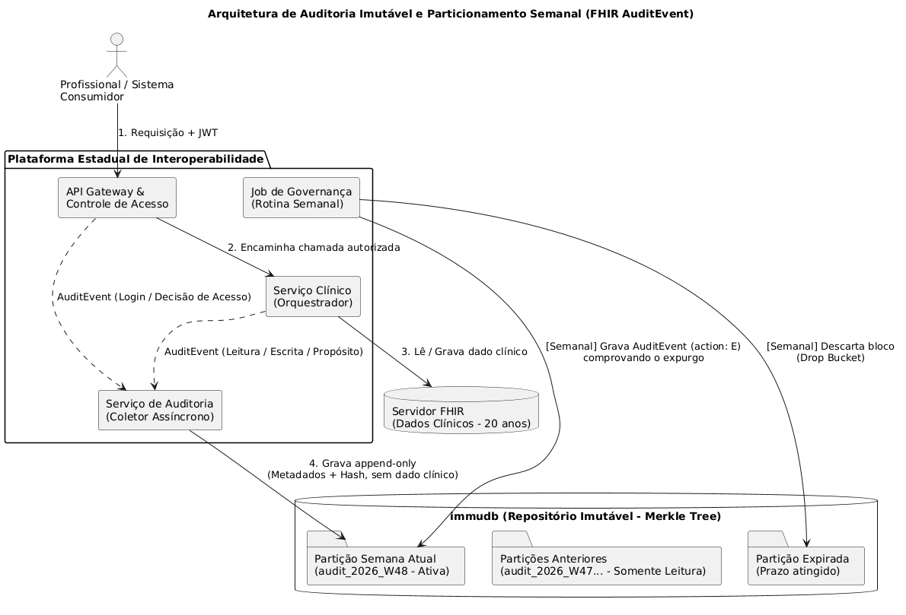

# Arquitetura de Auditoria e Rastreabilidade do Sistema

## 1. Propósito e Escopo Normativo
O subsistema de auditoria da **Plataforma Estadual de Interoperabilidade em Saúde** tem como objetivo registrar, de forma íntegra e não-repudiável, os eventos relevantes à segurança, privacidade e rastreabilidade operacional.

A modelagem fundamenta-se no recurso **`AuditEvent` do HL7 FHIR R4 (Seção 6.4)** — alinhado ao perfil **IHE-ATNA**, **DICOM (Anexo A5)**, **ISO 27789** e **NIST SP 800-92** — e atende às exigências legais da **LGPD (Lei nº 13.709/2018)** e do **Marco Civil da Internet (Lei nº 12.965/2014)**.

---

## 2. Eventos Relevantes que Precisam ser Registrados
Diferente de logs técnicos de depuração (*debug*), a auditoria captura eventos críticos de segurança e negócio. Conforme a seção **6.4.2 do FHIR R4**, os eventos auditáveis não se limitam a operações RESTful e abrangem sete categorias principais:

| Categoria do Evento (FHIR 6.4.2) | Exemplos na Plataforma | Ação FHIR (`action`) |
| :--- | :--- | :--- |
| **1. Ciclo de Vida de Software** | Inicialização e desligamento controlado de serviços e gateways. | `E` (Execute) |
| **2. Autenticação de Usuários** | Login, logout, emissão e expiração de tokens JWT. | `E` (Execute) |
| **3. Decisões de Controle de Acesso** | Permissão concedida ou bloqueio de acesso por falta de escopo/perfil. | `E` (Execute) |
| **4. Configuração e Políticas** | Alteração de regras de acesso, parâmetros de retenção ou instalação de módulos. | `U` (Update) / `C` (Create) |
| **5. Leitura e Consulta Clínica** | Busca ou recuperação de documentos clínicos (ex.: RAC, IPS, laudos). | `R` (Read) |
| **6. Modificação de Registros** | Criação, retificação/substituição ou invalidação de recursos clínicos. | `C` / `U` / `D` |
| **7. Sessões Efêmeras** | Criação, montagem e expiração (TTL) de sessões temporárias de síntese clínica. | `C` / `E` / `D` |

### Registro Multiator (Perspectivas Múltiplas)
Conforme previsto na seção **6.4.2 do FHIR R4**, todos os atores relevantes envolvidos em uma transação (como o **API Gateway** e o **Serviço Clínico**) podem emitir suas próprias entradas de `AuditEvent` para o mesmo evento. A correlação entre múltiplos registros permite detectar anomalias de segurança (por exemplo, uma requisição registrada no serviço interno sem passagem prévia pelo gateway de autorização).

---

## 3. Estrutura do Recurso `AuditEvent` e Minimização (LGPD)
Em cumprimento ao princípio da **minimização de dados (LGPD)**, conteúdo clínico sensível **nunca** é gravado nos logs de auditoria. O registro armazena apenas metadados de rastreio e o resumo criptográfico (*hash* SHA-256) do recurso manipulado.

Abaixo está o mapeamento dos elementos estruturais obrigatórios conforme a seção **6.4.3 do FHIR R4**:

| Elemento FHIR | Descrição e Regra de Uso na Plataforma | Exemplo Sintético |
| :--- | :--- | :--- |
| **`type` / `subtype`** | Classificação do evento segundo terminologia DICOM/FHIR (`rest`, `login`, `security`). | `rest` / `read` |
| **`action`** | Código da operação executada (`C`, `R`, `U`, `D`, `E`). | `R` |
| **`recorded`** | Instante exato (UTC) em que o evento foi registrado pelo coletor. | `2026-11-26T10:15:00Z` |
| **`outcome` / `outcomeDesc`** | Desfecho da operação (`0` = Sucesso, `4` = Falha menor, `8` = Falha grave). | `0` |
| **`purposeOfEvent`** | Propósito geral da atividade no nível do evento (Seção 6.4.3.6 — ex.: tratamento). | `TREAT` |
| **`agent.who` / `altId`** | Identificador do profissional/sistema solicitante e matrícula/usuário JWT. | `Practitioner/123` |
| **`agent.network.address`** | Endereço IP de origem da requisição. | `192.0.2.10` |
| **`agent.purposeOfUse`** | Motivo específico pelo qual aquele ator participou da operação (Seção 6.4.3.6). | `ETREAT` (Atendimento de urgência) |
| **`source.observer`** | Componente da plataforma que detectou e reportou o evento. | `Device/api-gateway-01` |
| **`entity.what` / `detail`** | Referência ao recurso afetado e hash SHA-256 para prova de integridade. | `Patient/789` / `sha256:a1b2c3...` |

> **Acesso e Imutabilidade (FHIR 6.4.2):** O acesso aos registros `AuditEvent` é restrito a administradores de segurança, auditores e DPO (nunca exposto diretamente a usuários finais). Operações de `UPDATE` e `DELETE` em nível de registro são estritamente bloqueadas.

---

## 4. Arquitetura, Imutabilidade (`immudb`) e Expurgo Semanal
A plataforma separa fisicamente o armazenamento assistencial das trilhas de auditoria, aplicando políticas de retenção distintas para cada base:

### Separação de Repositórios e Prazos Legais
* **Servidor FHIR (Dados Clínicos — 20 anos):** Aplica-se a **Lei nº 13.787/2018**, que exige a guarda de prontuários clínicos longitudinais por no mínimo 20 anos.
* **`immudb` (Logs de Auditoria — Retenção Curta e Particionamento Semanal):** A lei dos 20 anos **não** se aplica a logs técnicos de auditoria. Para registros de acesso a aplicações, adota-se o prazo mínimo legal de **6 meses previsto no Marco Civil da Internet (Lei nº 12.965/2014)** — ou prazo administrativo definido pela política de segurança da instituição (ex.: 1 a 5 anos) — respeitando o princípio de **limitação do armazenamento da LGPD** (eliminar dados assim que cessar a finalidade).

### Como Funciona o Particionamento e Expurgo Semanal (*Drop Bucket*)
Como o `immudb` é estritamente *append-only* e encadeia registros via **Merkle tree** (impedindo comandos `DELETE` individuais sem quebrar a assinatura criptográfica), o ciclo de vida dos logs é gerido em **blocos semanais**:

1. **Partições Semanais (`audit_YYYY_Www`):** Toda semana o sistema abre um novo *bucket* isolado (ex.: `audit_2026_W48`), com sua própria árvore de validação criptográfica. Quanto menor a janela da partição (semanal em vez de mensal ou anual), mais preciso e rápido é o descarte de dados vencidos.
2. **Selamento Semanal:** Ao encerrar a semana, a partição passa para modo somente leitura (*read-only*).
3. **Expurgo Semanal (*Drop Bucket*):** Um *job* agendado verifica semanalmente as partições que atingiram o limite da política de retenção e executa a exclusão física do bloco inteiro (*Drop Bucket*) no *storage*. Isso libera espaço em disco e cumpre a LGPD **sem afetar a integridade criptográfica das semanas posteriores**.
4. **Registro Auditável do Expurgo:** Ao descartar uma partição vencida, o serviço grava um novo `AuditEvent` (`action: E`) na partição semanal ativa registrando qual bloco foi eliminado e por qual política.

---

## 5. Resiliência e Backup
* **Coleta Assíncrona e Desacoplada:** O Serviço de Auditoria recebe eventos por meio de fila resiliente, garantindo que oscilações momentâneas no `immudb` não bloqueiem o atendimento clínico no Gateway (exceto em operações críticas de alteração de política, que exigem confirmação imediata).
* **Snapshots Criptografados:** Backups periódicos das partições vigentes são replicados em armazenamento seguro com criptografia em repouso (AES-256) e verificação automática da *Merkle tree* em testes de restauração.
