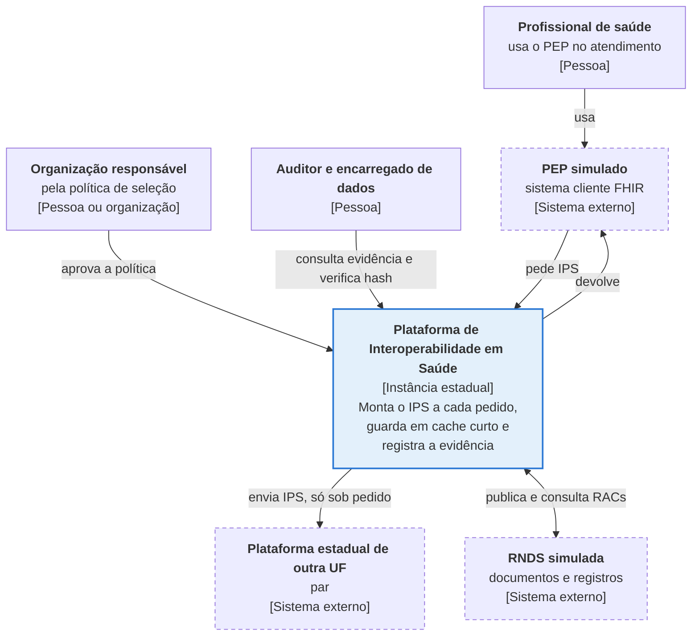
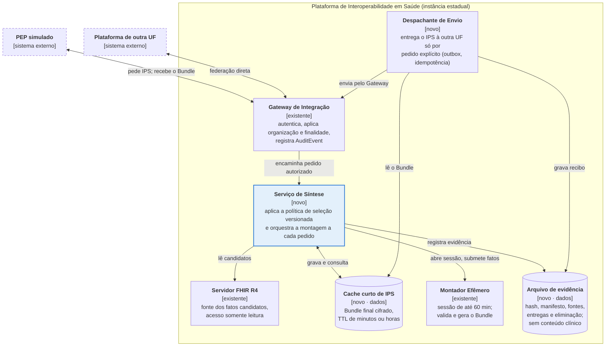
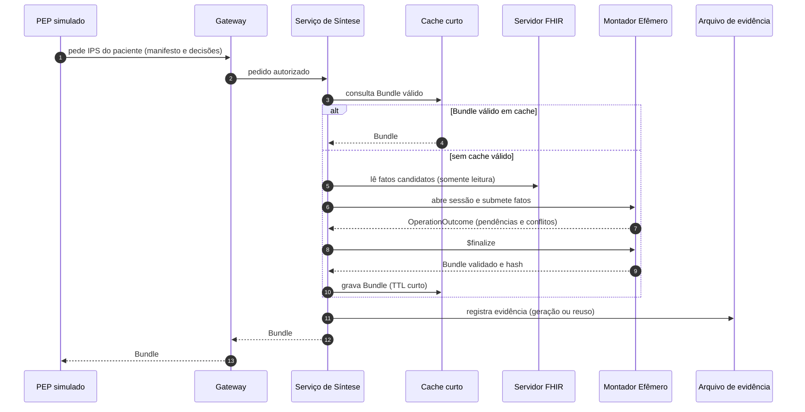
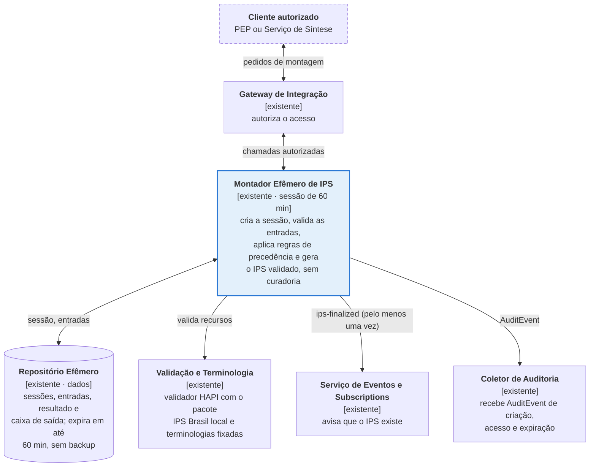
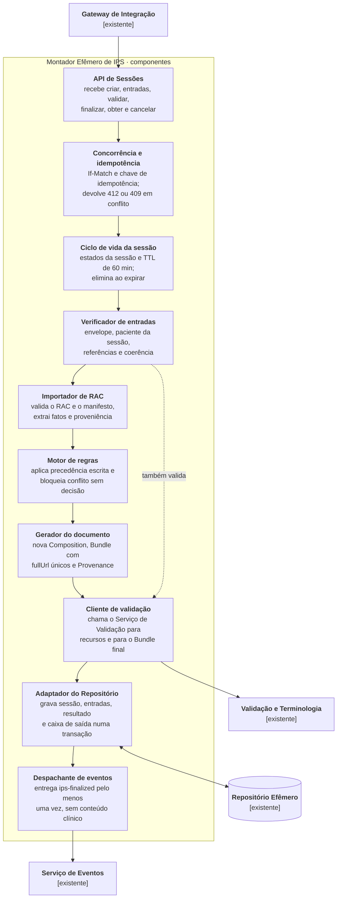
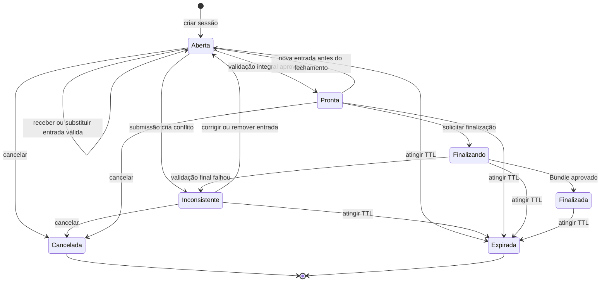

# Diagramas C4: IPS sob demanda e Montador Efêmero

## 1. Nível 1: contexto

A plataforma recebe o pedido do PEP, monta o IPS na hora e devolve o `Bundle`. O envio à outra UF só acontece por pedido explícito, e a organização responsável pela política é quem assume a autoria clínica.

Não mostra: Serviço de Documentos RNDS, validação de assinaturas, auditoria e telemetria.

---

## 2. Nível 2: contêineres

O Serviço de Síntese orquestra o pedido: lê os fatos, usa o Montador, grava o `Bundle` no cache curto e a evidência no Arquivo. O Despachante só atua quando o cliente pede o envio.

Não mostra: Validação e Terminologia e Repositório Efêmero (dentro do Montador, ver diagrama 4), assinatura digital e auditoria. De onde o Serviço de Síntese lê os RACs (Servidor FHIR ou Serviço de Documentos RNDS) está em aberto.

---

## 3. Sequência de um pedido

Em aberto: se um cache hit registra novo evento de evidência, e como o cache é invalidado quando chega um RAC novo durante o TTL.

---

## 4. Montador Efêmero, nível 2: contêineres

O Montador guarda tudo no Repositório Transacional Efêmero, que expira em até 60 minutos e não tem backup; o evento `ips-finalized` parte da caixa de saída desse mesmo repositório. O Montador não consulta fontes nem envia o IPS.

Não mostra: Serviço de Validação de Assinaturas e telemetria.

---

## 5. Montador Efêmero, nível 3: componentes

Leia do Gateway para baixo: a API recebe a chamada, os controles de versão e de estado a filtram, o Verificador, o Importador e o Motor preparam os fatos, e o Gerador produz o `Bundle` antes de gravar e avisar. A proposta só define o Montador como contêiner; estes componentes são sugestão para discussão.

Todos os componentes emitem `AuditEvent` ao Coletor de Auditoria (setas omitidas). A seta tracejada indica que o Cliente de validação também atende o Verificador.

---

## 6. Ciclo de vida da sessão do Montador

Reproduz o diagrama de estados da seção 14.6 da proposta.

