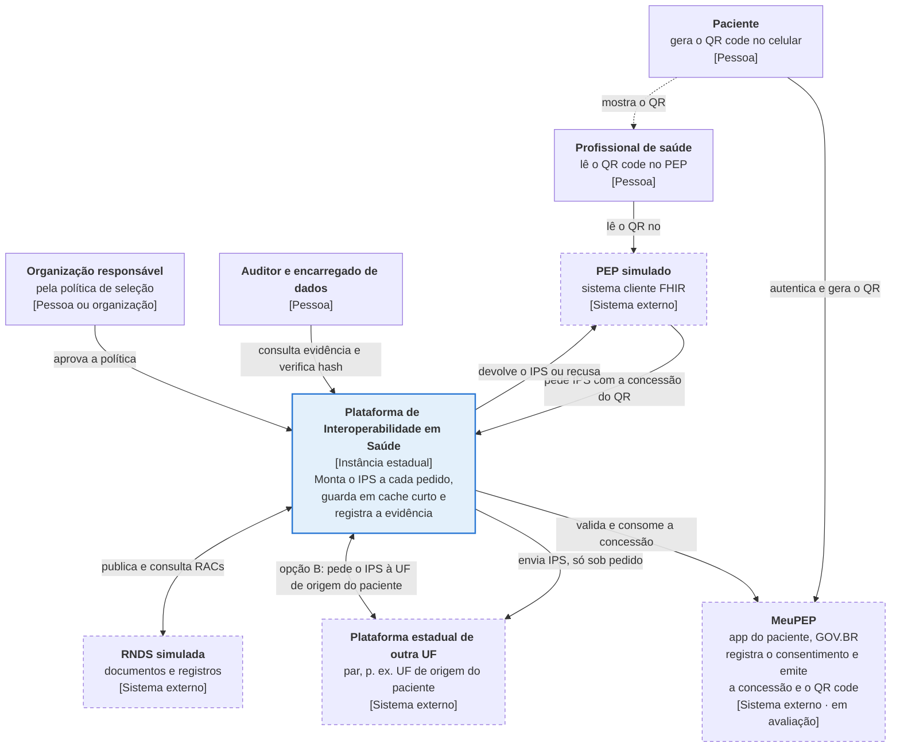
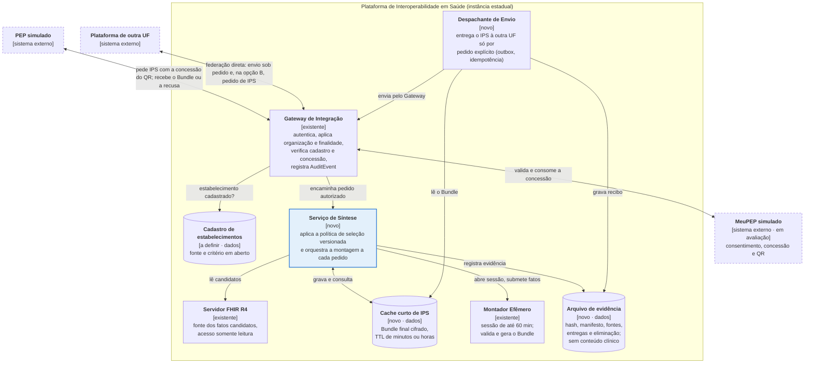
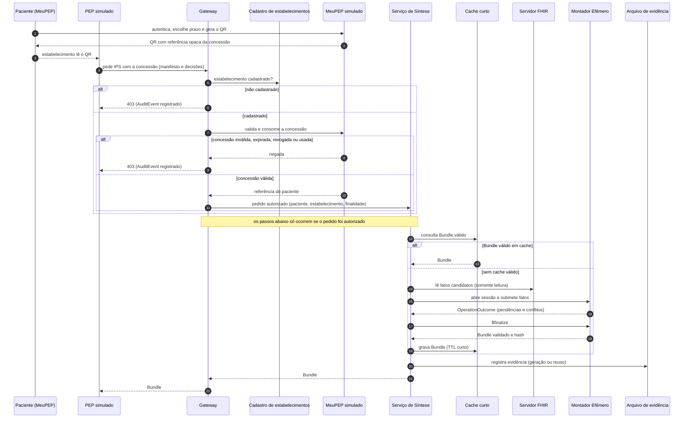
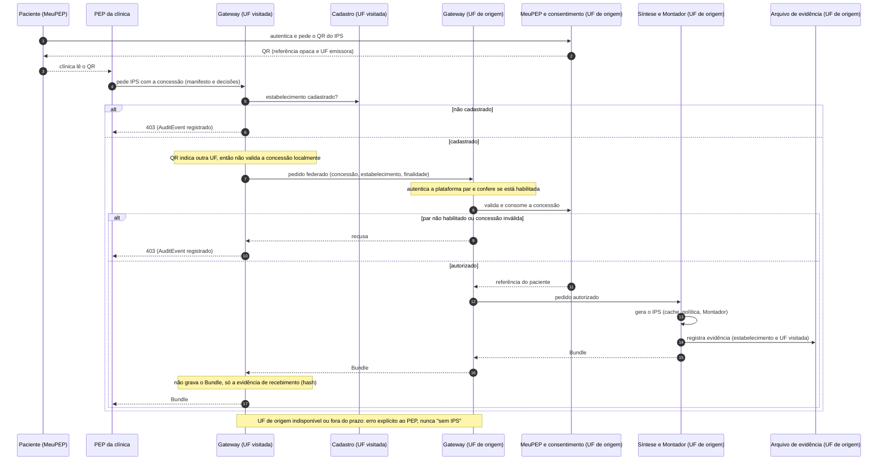

# Diagramas C4: IPS sob demanda e Montador Efêmero

## 1. Nível 1: contexto

O paciente gera um QR code no MeuPEP, o estabelecimento o lê no PEP e, se estiver cadastrado e a concessão for válida, a plataforma monta o IPS na hora e devolve o `Bundle`. O MeuPEP segue a proposta de autorização com GOV.BR, alternativa em avaliação. O envio à outra UF só acontece por pedido explícito, e a organização responsável pela política é quem assume a autoria clínica.

Não mostra: Serviço de Documentos RNDS, validação de assinaturas, auditoria e telemetria. A linha tracejada é a leitura do QR na tela do celular, sem comunicação entre sistemas.

---

## 2. Nível 2: contêineres

O Gateway só encaminha o pedido se o estabelecimento estiver no cadastro e a concessão do MeuPEP for válida. O Serviço de Síntese orquestra o pedido: lê os fatos, usa o Montador, grava o `Bundle` no cache curto e a evidência no Arquivo. O Despachante só atua quando o cliente pede o envio.

Não mostra: Validação e Terminologia e Repositório Efêmero (dentro do Montador), assinatura digital e auditoria. Em aberto: de onde o Serviço de Síntese lê os RACs (Servidor FHIR ou Serviço de Documentos RNDS), a fonte do cadastro de estabelecimentos e o protocolo entre Gateway e MeuPEP.

---

## 3. Sequência de um pedido (opção A: mesma UF)

O cache não dispensa a verificação do cadastro e da concessão: ela ocorre antes de qualquer consulta ao cache.

Em aberto: se um cache hit registra novo evento de evidência, e como o cache é invalidado quando chega um RAC novo durante o TTL.

---

## 3B. Sequência de um pedido da opção B (clínica em outra UF)

O QR é emitido pela UF de origem do paciente. A UF visitada reconhece pelo QR que é de outra UF e pede o IPS à UF de origem, por federação direta entre pares. O PEP só fala com o Gateway da própria UF.

Em aberto: se a UF de origem confia no cadastro da UF visitada ou mantém verificação própria, o que o QR revela da UF emissora, o tempo limite da chamada federada e a retenção do lado da UF visitada.
