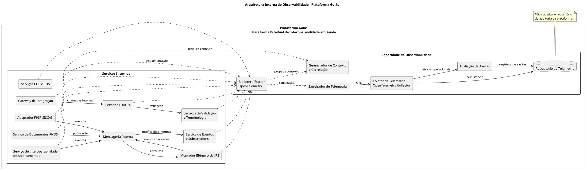
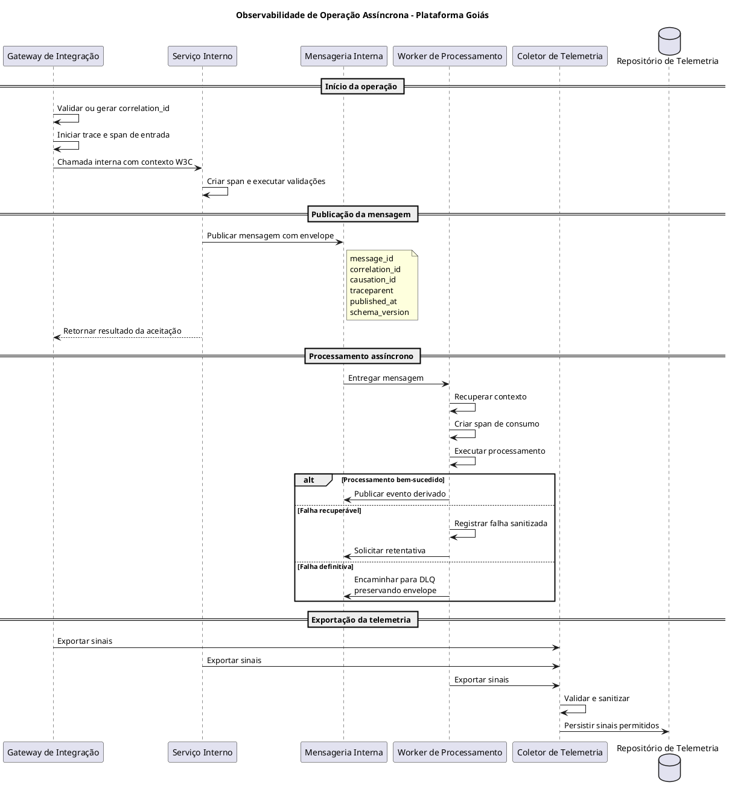

# Design de Software — Observabilidade Completa da Plataforma Goiás

**Sistema:** Plataforma Goiás — Plataforma Estadual de Interoperabilidade em Saúde  
**Documento:** Especificação de Design de Software  
**Versão:** 1.0 — Proposta para revisão  
**Status:** Em elaboração  
**Escopo:** Arquitetura e componentes internos de observabilidade da Plataforma Goiás.

---

## 1. Objetivo

Este documento define o design de software necessário para implementar a observabilidade da Plataforma Goiás, considerando os requisitos registrados em `docs/observabilidade.md` e as definições arquiteturais existentes em `docs/pratica.md`.

O objetivo é orientar os desenvolvedores na construção de uma capacidade interna que permita acompanhar, investigar e diagnosticar o funcionamento dos componentes da plataforma.

A solução deverá permitir:

1. Acompanhar as operações executadas internamente pela Plataforma Goiás.
2. Rastrear requisições que percorrem diferentes serviços.
3. Correlacionar operações síncronas e assíncronas.
4. Identificar falhas, gargalos e problemas de desempenho.
5. Coletar, processar, armazenar e consultar logs, métricas e rastros distribuídos.
6. Proteger dados pessoais e informações clínicas contra exposição na telemetria.
7. Garantir que falhas na infraestrutura de observabilidade não interrompam as operações de negócio.
8. Disponibilizar informações técnicas que permitam diagnosticar o comportamento da plataforma.

A observabilidade será implementada exclusivamente por componentes internos da Plataforma Goiás. Não faz parte deste design implementar mecanismos de observabilidade em aplicações clínicas externas, sistemas integrados ou outros participantes do ecossistema.

## 2. Escopo e fronteiras

### 2.1. Dentro do escopo

Fazem parte desta especificação:

- Instrumentação dos serviços internos.
- Biblioteca compartilhada de observabilidade.
- Gerenciamento e propagação de contexto.
- Geração e manutenção de identificadores de correlação.
- Rastreamento de chamadas HTTP.
- Rastreamento de operações assíncronas.
- Instrumentação de mensageria.
- Geração de logs estruturados.
- Coleta de métricas operacionais.
- Sanitização e filtragem da telemetria.
- Coletor de Telemetria.
- Repositório de Telemetria.
- Avaliação de alertas operacionais.
- Segurança e resiliência da infraestrutura.
- Testes automatizados.
- Critérios de aceitação.

### 2.2. Fora do escopo

Não fazem parte deste design:

- Implementação de observabilidade nas aplicações clínicas dos estabelecimentos de saúde.
- Implementação de mecanismos de monitoramento em sistemas externos.
- Desenvolvimento de funcionalidades de monitoramento para o Expresso Goiás fora da própria Plataforma Goiás.
- Desenvolvimento de um sistema de auditoria clínica.
- Implementação de interfaces de pacientes ou profissionais de saúde.
- Definição de funcionalidades assistenciais.
- Desenvolvimento de soluções comerciais externas de APM.

As integrações externas são consideradas apenas como fronteiras de entrada e saída das operações internas.

## 3. Referências e fundamentos arquiteturais

A definição considera as seguintes referências do projeto:

- `docs/observabilidade.md`: requisitos e decisões relacionados ao rastreamento distribuído.
- `docs/pratica.md`: arquitetura, componentes e práticas de desenvolvimento.
- `docs/contexto.puml`: modelo de contexto da Plataforma Goiás.
- `docs/imagens/contexto.svg`: representação visual da Plataforma Estadual de Interoperabilidade em Saúde.

As decisões já estabelecidas no repositório devem ser preservadas.

As especificações adicionais deste documento representam propostas de detalhamento de implementação e deverão ser submetidas à revisão arquitetural quando envolverem decisões ainda não aprovadas.

## 4. Conceitos fundamentais de observabilidade

A observabilidade será estruturada sobre três tipos principais de informações.

### 4.1. Logs

São registros de acontecimentos durante a execução dos serviços.

Exemplos:

- Uma solicitação foi recebida.
- Uma validação apresentou erro.
- Uma mensagem foi publicada.
- Uma operação foi concluída.
- Uma dependência interna ficou indisponível.

Os logs deverão permitir identificar o que aconteceu e em qual componente.

### 4.2. Métricas

São indicadores quantitativos sobre o funcionamento da plataforma.

Exemplos:

- Quantidade de requisições.
- Tempo de resposta.
- Quantidade de erros.
- Quantidade de mensagens pendentes.
- Número de retentativas.
- Consumo de memória.
- Taxa de falhas de processamento.

As métricas deverão permitir acompanhar o comportamento da plataforma ao longo do tempo.

### 4.3. Rastros distribuídos (Distributed Tracing)

Representam o caminho percorrido por uma operação através dos diferentes componentes internos.

Um rastro poderá conter diversas etapas, denominadas spans.

Cada span representa uma operação relevante, como uma chamada HTTP, uma validação, uma consulta ou um processamento de mensagem.

A utilização dos três sinais em conjunto deverá permitir investigar o comportamento da plataforma.

## 5. Identificadores e gerenciamento de contexto

A plataforma deverá utilizar identificadores distintos para representar diferentes aspectos de uma operação.

| Identificador | Finalidade |
|---|---|
| `trace_id` | Identifica um rastreamento técnico distribuído. |
| `span_id` | Identifica uma etapa específica dentro de um rastreamento. |
| `correlation_id` | Identifica uma intenção de negócio e permite relacionar seus eventos. |
| `message_id` | Identifica individualmente uma mensagem. |
| `causation_id` | Identifica a mensagem que originou diretamente um evento derivado. |

### 5.1. Regras de utilização

**trace_id**

Identifica o rastreamento técnico de uma execução. Pode mudar quando uma operação assíncrona inicia um novo rastreamento.

**span_id**

Identifica uma etapa específica. Cada operação instrumentada relevante deverá possuir seu próprio span.

**correlation_id**

Identifica a intenção de negócio. Deverá permanecer estável durante as diferentes etapas e eventos relacionados à mesma solicitação.

**message_id**

Cada mensagem publicada deverá receber um identificador único.

**causation_id**

Quando um evento for produzido em consequência de uma mensagem anterior, deverá identificar o `message_id` que originou diretamente o novo evento.

### 5.2. Geração do correlation_id

O Gateway de Integração será responsável por inicializar ou normalizar o contexto de correlação.

Regras:

1. Quando o identificador não estiver presente, deverá gerar um UUID v4.
2. Quando estiver presente e for válido, deverá preservá-lo.
3. Quando estiver malformado, deverá gerar um novo identificador.
4. O valor inválido original não deverá ser armazenado nos logs.
5. O identificador deverá ser propagado para os componentes internos envolvidos na operação.

A chave de idempotência de uma operação de negócio deverá permanecer independente desses identificadores.

## 6. Arquitetura lógica de observabilidade

A observabilidade será organizada em seis capacidades lógicas:

1. Instrumentação OpenTelemetry.
2. Gerenciamento de contexto e correlação.
3. Sanitização da telemetria.
4. Coletor de Telemetria.
5. Repositório de Telemetria.
6. Avaliação de alertas.

### 6.1. Diagrama de componentes

![Não carregou](https://www.plantuml.com/plantuml/png/XLKzSoD54CttLtGvjqc82AvEICAui2sVf384JbgxBLtNxSuiCxq2G_5ZA88hBgL8IFUFqRs3LrDYCKuq7wzVl-dNlNuR1ODqJLq8Iqqm2zztB2HTGBXnGi4XL0IhNQHmn1tNNA7kB-6XHi6z3mt2jUV-rrWKDUq5n4FWmtk1YWELmjuLyGEx5WCsKFgczOwSREHPana0tQ6c3D9Y-G4FT0ue_Zc7YtybVdBPqJ8ALXtMAZhfzos5asvgO8FzNnLTmCz50VetycxqWTn_z375EHyD0-dlf1mkhb7e1tn-oN08s7_iV_CNW16klvs8IDIL3_3LrpThM7zkq64z2HvrQ897LE69_yaHR2aqx7pj3um3oUFizZKEerZuiclqL0dNzulD4BPOpQV2xhmJD9tBVV-feJ34tpoa6FrzBTLqmP-S7jzHnIKc3GFLtN8nHJMhi1LygTFbvcOpdzqF0RhylzpBuy1lLTfqkrW6RgtvKiBbu_RrKi_VtGB1F9N7VYVBGoxYWGAFev5Uysu0_tBMJtFKvL24YG7wZzRwadSrUw4IFzlON59uSgkMt9PgQaZ2Swh6ufl9lgH0hcGhe6MSUzNuesZVs3e4ghC-dM-_com8EXR-wONY9IrZoZkxdmgQ-vhaFE1CDoYefb9XAVrgicrdHwmvgJIsMKr1C3aukrskJnvMABZ3g5LUK-iZI_z7O3yXURryoCpHyOIhgpTMGFW2s4K9msYab8P84vemgSWwOVdUHYVVsrZaU-ljV6-jc--j5VEzzTguppMgGuD6LaThjGJAv6UIgUWCrUhGuM4QOguf92PdivVQ-UNb6_D2xrVRsrGfszgnLiwOAKIEqd-onihlao6AQFhV9N294OR1Bzaxv6ZG1Cd80XsKAwGl6oPpnpSRp8glkF8zDbWf8wSfYwCpXZ9757GyVHb7N_HMfz5aTpf7PNQhftffPXc_Tx5h_6ZV64Rf6wBo0X-nyd5qz1moMZjvaRAPrNhXlF0-YVcJiZTfI-eLmSwB-0RyVcZMU-lzg1ymOUaOF8IimGkhMrUn-C085K8x_kExAiXLO8H5yLQNNLF_3G00)



Os serviços apresentados representam os componentes internos considerados na proposta arquitetural. A instrumentação deverá ser aplicada aos serviços efetivamente existentes e implementados no projeto.

O diagrama representa responsabilidades lógicas, não exige que cada componente seja executado em uma instância física independente.

## 7. Responsabilidades dos componentes

### 7.1. Biblioteca/Starter OpenTelemetry

Será uma dependência compartilhada pelos serviços internos da plataforma.

Responsabilidades:

- Inicializar o SDK OpenTelemetry.
- Configurar exportadores.
- Identificar o serviço e sua versão.
- Instrumentar chamadas HTTP.
- Instrumentar operações de mensageria.
- Criar spans customizados quando necessário.
- Coletar métricas.
- Emitir logs estruturados.
- Propagar contexto.
- Aplicar as regras de sanitização.

A biblioteca deverá permitir configuração externa, evitando alterações no código de negócio para modificar parâmetros operacionais.

A instrumentação automática e manual deverá ser combinada sem produzir spans duplicados.

### 7.2. Gerenciador de Contexto e Correlação

Responsabilidades:

- Interpretar os cabeçalhos W3C.
- Validar o `X-Correlation-ID`.
- Gerar identificadores quando necessário.
- Manter o contexto durante a execução.
- Propagar o contexto entre serviços.
- Inserir e recuperar metadados nos envelopes de mensagens.
- Preservar a correlação entre retentativas e eventos derivados.

O gerenciamento de contexto deverá respeitar o ciclo de vida das requisições e operações concorrentes, sem misturar identificadores entre execuções distintas.

### 7.3. Sanitizador de Telemetria

Responsabilidades:

- Aplicar lista positiva de atributos permitidos.
- Remover informações sensíveis.
- Impedir a exportação de corpos clínicos.
- Sanitizar exceções e mensagens de erro.
- Remover parâmetros sensíveis de URLs.
- Evitar atributos de alta cardinalidade.
- Impedir a exportação de credenciais e segredos.

A sanitização deverá acontecer antes da exportação dos sinais e ser reforçada pelo coletor.

### 7.4. Coletor de Telemetria

Será implementado utilizando OpenTelemetry Collector.

Responsabilidades:

- Receber sinais por OTLP.
- Validar atributos.
- Normalizar metadados.
- Aplicar filtros e processadores.
- Controlar memória.
- Organizar lotes de exportação.
- Encaminhar os sinais ao repositório.
- Expor métricas sobre seu próprio funcionamento.

O coletor deverá ser executado na infraestrutura controlada pela Plataforma Goiás.

### 7.5. Repositório de Telemetria

Responsabilidades:

- Armazenar logs técnicos.
- Armazenar métricas.
- Armazenar rastros distribuídos.
- Permitir consultas por `trace_id` e `correlation_id`.
- Permitir análise temporal.
- Aplicar políticas de retenção.
- Controlar o acesso às informações operacionais.

A tecnologia definitiva de armazenamento deverá ser escolhida conforme as necessidades de implantação e as decisões arquiteturais do projeto.

### 7.6. Avaliação de Alertas

Deverá identificar situações que indiquem problemas operacionais.

Exemplos:

- Aumento de erros HTTP.
- Aumento da latência.
- Crescimento de filas.
- Aumento de retentativas.
- Mensagens em DLQ.
- Falhas de exportação de telemetria.
- Indisponibilidade do coletor.
- Indisponibilidade do repositório.

Os limites numéricos deverão ser configuráveis e definidos após a aprovação dos objetivos de desempenho e disponibilidade.

## 8. Propagação de contexto em chamadas HTTP

A comunicação entre serviços internos deverá propagar o contexto de observabilidade por meio dos cabeçalhos definidos pelo W3C e pelo contrato interno da plataforma.

### 8.1. Cabeçalhos

| Cabeçalho | Finalidade |
|---|---|
| `traceparent` | Propaga o contexto técnico do rastreamento. |
| `tracestate` | Transporta informações adicionais do rastreamento. |
| `baggage` | Transporta metadados operacionais permitidos. |
| `X-Correlation-ID` | Identifica a intenção de negócio. |

### 8.2. Regras

1. O Gateway deverá inicializar o contexto.
2. O `traceparent` deverá ser interpretado e propagado conforme o padrão W3C.
3. O `tracestate` deverá ser preservado quando válido.
4. O `X-Correlation-ID` deverá permanecer associado à operação.
5. O `baggage` deverá conter apenas atributos permitidos.
6. Os serviços deverão criar spans para operações relevantes.
7. Os cabeçalhos inválidos não deverão interromper automaticamente uma operação de negócio.
8. A resposta deverá devolver o `X-Correlation-ID` para facilitar o diagnóstico e o suporte.
9. A propagação de `traceparent` nas respostas deverá seguir o contrato de comunicação definido no projeto.

### 8.3. Baggage

O Baggage deverá ser utilizado exclusivamente para metadados operacionais permitidos.

Exemplos possíveis:

- `correlation_id`;
- `tenant_uf`, quando necessário.

Não deverão ser transportados:

- CPF;
- CNS;
- nomes;
- diagnósticos;
- prescrições;
- laudos;
- textos clínicos;
- tokens de autenticação.

A utilização de `patient_ref_pseudo` deverá depender de justificativa técnica e aprovação de privacidade. Não deverá ser habilitada por padrão.

### 8.4. Respostas de erro

Quando uma operação apresentar falha, a resposta deverá permitir identificar a referência de correlação.

Para respostas FHIR `OperationOutcome`, poderá ser utilizada a informação de diagnóstico para apresentar uma referência técnica, sem reproduzir dados pessoais ou clínicos.

Exemplo ilustrativo:

```json
{
  "resourceType": "OperationOutcome",
  "issue": [
    {
      "severity": "error",
      "code": "exception",
      "diagnostics": "Falha técnica. Referência de suporte: 3f9c9b7e-7e51-4c8b-8d4f-a2b40c3d7a10"
    }
  ]
}
```

O exemplo representa uma possibilidade de implementação e não estabelece um código definitivo para todas as falhas.

## 9. Propagação de contexto em mensageria

As operações assíncronas deverão preservar o contexto necessário para reconstruir a origem e a sequência de processamento.

### 9.1. Envelope de mensagens

Cada mensagem deverá possuir um envelope de controle separado do conteúdo clínico.

| Campo | Obrigatoriedade | Descrição |
|---|---|---|
| `message_id` | Obrigatório | Identificador único da mensagem. |
| `correlation_id` | Obrigatório | Identificador da intenção de negócio. |
| `causation_id` | Quando aplicável | Identificador da mensagem que originou o evento. |
| `traceparent` | Obrigatório nas mensagens produzidas por componentes instrumentados | Contexto W3C. |
| `tracestate` | Quando presente | Estado adicional do rastreamento. |
| `baggage` | Opcional | Metadados operacionais permitidos. |
| `published_at` | Obrigatório | Data e hora de publicação em UTC. |
| `schema_version` | Obrigatório | Versão do envelope. |
| `event_type` | Obrigatório | Tipo do evento produzido. |

O transporte poderá utilizar cabeçalhos do broker ou um envelope próprio, desde que os metadados permaneçam separados do payload clínico.

### 9.2. Retentativas

Durante uma retentativa:

- O `message_id` original deverá ser preservado.
- O `correlation_id` deverá permanecer estável.
- Cada tentativa deverá gerar evidência técnica própria.
- A tentativa deverá ser identificável nos rastros.
- O processamento não deverá duplicar efeitos de negócio por falta de controle de idempotência.

Quando uma nova execução assíncrona iniciar outro trace, deverá existir um vínculo causal com o contexto anterior, preferencialmente por span links.

### 9.3. Dead-Letter Queue (DLQ)

Mensagens que não puderem ser processadas deverão ser encaminhadas para a DLQ conforme a política de mensageria.

O envelope original deverá ser preservado.

A mensagem deverá receber informação técnica sobre o motivo do encaminhamento, como `x-death-reason`, sem incluir conteúdo clínico ou pessoal.

A origem da mensagem e a sequência de tentativas deverão continuar identificáveis.

### 9.4. Mensagens sem contexto

Mensagens sem `traceparent` ou `correlation_id` não deverão ser descartadas exclusivamente por essa ausência.

O consumidor deverá:

1. Criar um novo contexto técnico quando necessário.
2. Gerar um `correlation_id` quando ausente.
3. Registrar a ausência do contexto original por meio de informação operacional sanitizada.
4. Permitir o processamento normal, desde que os demais requisitos de negócio estejam atendidos.

## 10. Padrão de traces e spans

Os serviços deverão utilizar as convenções semânticas do OpenTelemetry.

Os spans deverão representar operações relevantes, sem registrar indiscriminadamente cada linha de código.

Exemplos de operações customizadas:

| Operação | Nome sugerido |
|---|---|
| Validação FHIR | `fhir.validate` |
| Consulta FHIR | `fhir.search` |
| Publicação de documento | `rnds.document.publish` |
| Montagem de IPS | `ips.assemble` |
| Correlação de medicamentos | `medication.correlate` |
| Entrega de notificação | `subscription.deliver` |

Para operações HTTP e mensageria, deverão ser utilizadas as convenções semânticas oficiais do OpenTelemetry.

### 10.1. Atributos permitidos

Exemplos:

- `service.name`;
- `service.version`;
- `deployment.environment.name`;
- `correlation_id`;
- `message_id`, quando aplicável;
- `causation_id`, quando aplicável;
- `http.request.method`;
- `http.route`;
- `http.response.status_code`;
- `error.type`;
- `fhir.resource.type`, quando necessário;
- `messaging.destination.name`, quando necessário.

Os atributos não deverão conter dados pessoais, identificadores de pacientes ou conteúdo clínico.

Não deverão ser utilizados caminhos completos com parâmetros sensíveis ou nomes de spans com valores variáveis de alta cardinalidade.

## 11. Logs estruturados

Os logs técnicos deverão ser emitidos preferencialmente em JSON.

### 11.1. Campos mínimos

| Campo | Descrição |
|---|---|
| `timestamp` | Data e hora do evento em UTC. |
| `severity` | Nível de severidade. |
| `service.name` | Serviço responsável. |
| `service.version` | Versão do serviço. |
| `deployment.environment.name` | Ambiente de execução. |
| `trace_id` | Identificador do rastreamento, quando disponível. |
| `span_id` | Identificador da etapa, quando disponível. |
| `correlation_id` | Identificador da intenção de negócio. |
| `event.name` | Tipo do evento operacional. |
| `operation` | Operação executada. |
| `outcome` | Resultado técnico. |
| `error.type` | Classificação do erro, quando aplicável. |

### 11.2. Regras de implementação

- Não registrar corpos completos de requisições ou respostas.
- Não registrar tokens, cookies, senhas ou credenciais.
- Não registrar CPF, CNS, nomes ou endereços.
- Não registrar textos de laudos ou prescrições.
- Não registrar parâmetros de URL sem sanitização.
- Não registrar mensagens de exceção sem filtragem.
- Evitar duplicação de registros por exportadores diferentes.
- Utilizar níveis de severidade padronizados.

Os níveis de log deverão seguir uma política consistente: `DEBUG`, `INFO`, `WARN` e `ERROR`.

## 12. Métricas operacionais

As métricas deverão permitir acompanhar o funcionamento dos serviços sem depender da identificação individual de pacientes ou operações.

### 12.1. Métricas mínimas

| Grupo | Métricas |
|---|---|
| HTTP | Quantidade de requisições, duração e códigos de resposta. |
| Serviços internos | Duração e resultado das principais operações. |
| Mensageria | Profundidade de filas, duração de processamento e retentativas. |
| DLQ | Quantidade de mensagens encaminhadas. |
| Persistência | Duração e falhas de operações de armazenamento. |
| JVM | Memória, coleta de lixo e threads. |
| Telemetria | Falhas de exportação, descartes e registros recusados. |
| Contexto | Contextos gerados por ausência ou invalidade de cabeçalhos. |

### 12.2. Controle de cardinalidade

Não utilizar como rótulos de métricas:

- `correlation_id`;
- `trace_id`;
- `span_id`;
- `message_id`;
- CPF;
- CNS;
- identificadores de recursos FHIR;
- URLs completas com parâmetros;
- mensagens de erro.

Os rótulos deverão utilizar valores controlados, como nome do serviço, operação, ambiente e classe de resultado.

A consulta individual deverá utilizar traces e logs.

## 13. Sanitização e proteção dos dados

A proteção deverá ser aplicada em duas camadas.

### 13.1. Sanitização na aplicação

Antes da exportação, os serviços deverão:

1. Aplicar uma lista positiva de atributos permitidos.
2. Remover campos desconhecidos que possam conter informações sensíveis.
3. Desabilitar a captura automática de corpos clínicos.
4. Sanitizar exceções e mensagens de erro.
5. Padronizar caminhos de requisições.
6. Impedir a inclusão de parâmetros clínicos em spans e métricas.

### 13.2. Sanitização no coletor

O OpenTelemetry Collector deverá aplicar filtros e processadores adicionais.

A configuração deverá:

- Remover atributos sensíveis conhecidos.
- Descartar sinais com campos proibidos.
- Normalizar metadados de serviços.
- Aplicar limites de memória.
- Controlar lotes de processamento.
- Impedir que registros descartados sejam armazenados em destinos alternativos sem sanitização.

A filtragem no coletor será uma segunda camada de proteção, não substituindo a sanitização na aplicação.

## 14. Coleta e armazenamento

### 14.1. Pipeline de telemetria

O fluxo deverá seguir a seguinte sequência:

1. Os serviços internos geram traces, logs e métricas.
2. A instrumentação aplica a sanitização local.
3. Os sinais são enviados por OpenTelemetry Protocol (OTLP).
4. O Coletor de Telemetria recebe os sinais.
5. O coletor valida, normaliza e sanitiza os atributos.
6. Os sinais permitidos são encaminhados ao Repositório de Telemetria.
7. A capacidade de alertas utiliza as métricas operacionais para identificar condições relevantes.

### 14.2. Processadores do coletor

A configuração deverá considerar, conforme compatibilidade da versão escolhida:

- Receptores OTLP para gRPC e HTTP.
- `memory_limiter`.
- Processadores de atributos.
- Processadores de redação.
- Processadores de normalização.
- `batch`.
- Exportadores compatíveis com o repositório.
- Métricas de funcionamento do próprio coletor.

### 14.3. Retenção

O prazo de sete dias apresentado no documento original poderá ser utilizado como referência inicial para traces no ambiente da disciplina.

Esse prazo não deverá ser considerado automaticamente uma política definitiva de produção.

A retenção de logs, métricas e eventos de negócio deverá ser definida separadamente.

Os identificadores de correlação presentes em registros de negócio e auditoria não deverão depender da retenção dos traces técnicos para continuar rastreáveis.

### 14.4. Amostragem

Para o ambiente de desenvolvimento e testes, recomenda-se rastreamento integral, facilitando a validação dos fluxos.

A política de amostragem de produção deverá ser definida posteriormente, considerando volume, capacidade de armazenamento, criticidade das operações e necessidade de preservar evidências de falhas.

A amostragem não deverá eliminar indiscriminadamente os rastros necessários à investigação de erros críticos.

## 15. Separação entre observabilidade e auditoria

A observabilidade e a auditoria são capacidades diferentes e deverão permanecer separadas.

**Observabilidade operacional**

Permite investigar:

- Como uma operação foi executada.
- Quanto tempo levou.
- Quais serviços participaram.
- Onde ocorreu uma falha.
- Quais dependências técnicas foram utilizadas.

**Auditoria**

Preserva evidências de:

- Acessos a informações em saúde.
- Alterações de informações.
- Operações que exigem responsabilização.
- Eventos sujeitos a requisitos específicos de integridade e retenção.

O Repositório de Telemetria não deverá substituir o Repositório de Auditoria.

A telemetria poderá auxiliar na investigação técnica de um evento de auditoria, mas não será considerada a evidência oficial desse evento.

## 16. Segurança da infraestrutura de observabilidade

A infraestrutura deverá implementar:

- Comunicação protegida entre serviços e coletor, conforme a topologia.
- Acesso restrito aos endpoints de ingestão.
- Isolamento do tráfego de telemetria.
- Controle de acesso ao repositório.
- Proteção dos segredos utilizados pelos exportadores.
- Criptografia em trânsito e em repouso, conforme a infraestrutura adotada.
- Limites de memória e tamanho dos lotes.
- Sanitização antes da persistência.
- Métricas de saúde dos componentes de observabilidade.

Não deverão existir endpoints públicos de consulta aos rastros e logs.

## 17. Resiliência e comportamento em falhas

A observabilidade deverá operar de forma desacoplada do processamento de negócio.

Quando o coletor ou o repositório estiver indisponível:

1. O processamento de negócio deverá continuar, desde que seus próprios componentes estejam operacionais.
2. O exportador poderá realizar retentativas com espera progressiva.
3. As filas de telemetria deverão possuir limites de memória e tamanho.
4. Os descartes deverão ser contabilizados.
5. A recuperação deverá permitir o envio dos sinais ainda disponíveis.
6. A indisponibilidade da telemetria não deverá alterar o estado de recursos FHIR.

Não deverá existir dependência síncrona obrigatória da persistência de cada span ou log para concluir uma operação de negócio.

## 18. Configuração por ambiente

A configuração deverá ser externalizada.

Exemplo de variáveis de ambiente:

```bash
OTEL_SERVICE_NAME=plataforma-goias-gateway
OTEL_RESOURCE_ATTRIBUTES=service.namespace=plataforma-goias,deployment.environment.name=local
OTEL_PROPAGATORS=tracecontext,baggage
OTEL_TRACES_SAMPLER=always_on
OTEL_EXPORTER_OTLP_ENDPOINT=http://telemetry-collector:4317
OTEL_EXPORTER_OTLP_PROTOCOL=grpc
```

Os valores deverão ser ajustados individualmente para cada serviço e ambiente.

A configuração de produção deverá considerar uma política de amostragem própria.

As versões de Java, Spring Boot, OpenTelemetry e OpenTelemetry Collector deverão ser fixadas de maneira compatível com a arquitetura do projeto.

## 19. Testes de software

A implementação deverá possuir testes que comprovem o funcionamento da observabilidade.

### 19.1. Testes unitários

- Geração de `correlation_id`.
- Validação dos cabeçalhos.
- Propagação do contexto W3C.
- Sanitização de atributos.
- Redação de mensagens de erro.
- Construção do envelope de mensagens.
- Classificação de falhas.

### 19.2. Testes de integração

- Propagação de contexto entre serviços.
- Preservação do `correlation_id` em operações assíncronas.
- Criação de spans HTTP.
- Criação de spans de mensageria.
- Exportação por OTLP.
- Recepção pelo coletor.
- Persistência dos sinais.
- Funcionamento das métricas do coletor.

### 19.3. Testes de privacidade

Os testes deverão utilizar dados sintéticos marcadores para verificar que informações proibidas não aparecem:

- Nos logs.
- Nos atributos dos spans.
- Nos nomes dos spans.
- Nas métricas.
- Nos rótulos.
- Nas mensagens de erro.
- Nos registros persistidos.

Deverão ser utilizados exemplos sintéticos de identificadores pessoais, textos clínicos, tokens fictícios e parâmetros de URL.

### 19.4. Testes de resiliência

- Indisponibilidade do coletor.
- Indisponibilidade do repositório.
- Retentativas de exportação.
- Esgotamento de filas limitadas.
- Mensagens sem `traceparent`.
- Mensagens sem `correlation_id`.
- Cabeçalhos inválidos.
- Reprocessamento com novo trace.
- Preservação do envelope na DLQ.
- Contabilização de descartes.

## 20. Diagrama de sequência de uma operação assíncrona

O diagrama abaixo apresenta o comportamento esperado de uma operação interna, desde a entrada até a persistência da telemetria.




## 21. Critérios de aceitação

A implementação deverá ser considerada verificada quando houver evidências reproduzíveis de que:

1. Os serviços internos instrumentados emitem telemetria padronizada.
2. A propagação HTTP preserva o contexto técnico.
3. O `correlation_id` permanece estável nas operações relacionadas.
4. As mensagens assíncronas transportam o envelope definido.
5. O processamento assíncrono pode ser correlacionado mesmo após o início de um novo trace.
6. Retentativas e DLQ preservam a relação causal.
7. Os sinais são recebidos pelo coletor e persistidos no repositório.
8. Dados pessoais e conteúdo clínico integral não aparecem na telemetria.
9. A indisponibilidade da infraestrutura de observabilidade não bloqueia as operações de negócio.
10. As métricas permitem identificar falhas de coleta e processamento.
11. Os testes automatizados comprovam propagação, sanitização e resiliência.
12. As políticas de retenção e amostragem são configuráveis e documentadas.

Cada critério deverá possuir evidência de teste, registro de resultado ou demonstração técnica.

Testes não executados não poderão ser considerados aprovados.

## 22. Decisões técnicas pendentes

Antes da implementação definitiva, deverão ser deliberadas:

1. Versões compatíveis de Java, Spring Boot, OpenTelemetry e OpenTelemetry Collector.
2. Tecnologia de armazenamento do Repositório de Telemetria.
3. Retenção de logs e métricas e confirmação da retenção de traces por ambiente.
4. Política de amostragem em produção.
5. Padrão definitivo de nomenclatura de spans customizados.
6. Política de aceitação de mensagens legadas sem contexto.
7. Regras de pseudonimização, caso seja necessário utilizar `patient_ref_pseudo`.
8. Limites de desempenho, latência e cardinalidade.
9. Limites e prioridades das regras de alertas.
10. Estratégia definitiva de testes e infraestrutura.

As decisões arquiteturalmente significativas deverão ser registradas por meio de ADR, conforme a governança do projeto.

## 23. Referências técnicas

- [Repositório do projeto](https://github.com/kyriosdata/design-2026-02)
- [Requisitos de observabilidade](https://github.com/kyriosdata/design-2026-02/blob/main/docs/observabilidade.md)
- [Prática e arquitetura do projeto](https://github.com/kyriosdata/design-2026-02/blob/main/docs/pratica.md)
- [Diagrama de contexto](https://github.com/kyriosdata/design-2026-02/blob/main/docs/imagens/contexto.svg)
- [OpenTelemetry](https://opentelemetry.io/docs/)
- [OpenTelemetry Collector](https://opentelemetry.io/docs/collector/)
- [OpenTelemetry Semantic Conventions](https://opentelemetry.io/docs/specs/semconv/)
- [W3C Trace Context](https://www.w3.org/TR/trace-context/)
- [W3C Baggage](https://www.w3.org/TR/baggage/)

---

**Fim da especificação.**
