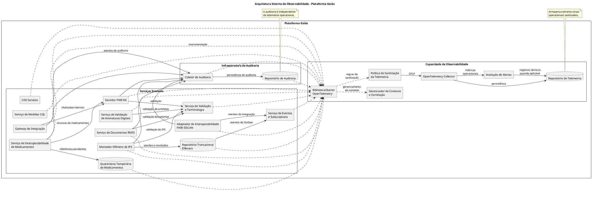
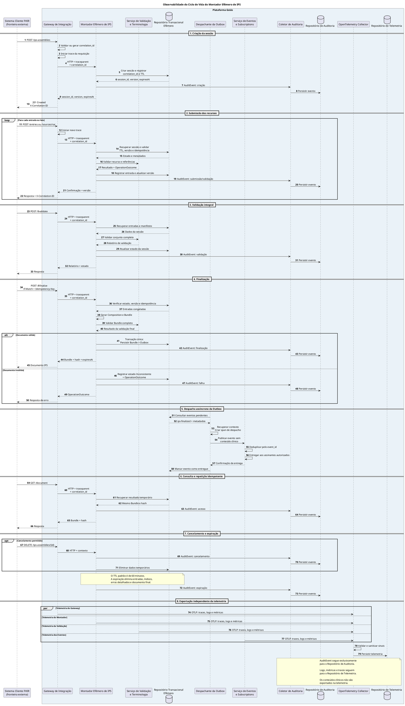

# Design de Software — Observabilidade Completa da Plataforma Goiás

**Sistema:** Plataforma Goiás — Plataforma Estadual de Interoperabilidade em Saúde  
**Documento:** Especificação de Design de Software  
**Versão:** 2.0 — Proposta consolidada para revisão  
**Status:** Em revisão arquitetural  
**Escopo:** Arquitetura e implementação da observabilidade interna da Plataforma Goiás.

---

# 1. Objetivo

Este documento estabelece a definição de design de software necessária para implementar os mecanismos de observabilidade da Plataforma Goiás, considerando os requisitos registrados em `docs/observabilidade.md` e a arquitetura de software descrita em `docs/pratica.md`.

O objetivo é fornecer especificações técnicas suficientes para orientar os desenvolvedores na implementação de mecanismos que permitam acompanhar, investigar e diagnosticar o funcionamento interno da plataforma.

A solução deverá possibilitar:

1. Acompanhar as operações executadas pelos componentes internos da Plataforma Goiás.
2. Rastrear requisições que percorrem diferentes serviços e contêineres.
3. Correlacionar operações síncronas e assíncronas.
4. Identificar falhas, gargalos e problemas de desempenho.
5. Coletar, processar, armazenar e consultar logs, métricas e rastros distribuídos.
6. Preservar a correlação de eventos mesmo quando uma operação ultrapassar o ciclo de vida de uma requisição HTTP.
7. Identificar problemas na comunicação entre componentes internos.
8. Proteger dados pessoais, informações clínicas, credenciais e outros dados sensíveis contra exposição na telemetria.
9. Garantir que falhas na infraestrutura de observabilidade não interrompam as operações de negócio.
10. Disponibilizar informações técnicas que permitam diagnosticar o comportamento da plataforma.
11. Estabelecer testes e critérios verificáveis para comprovar o funcionamento da observabilidade.

A observabilidade será implementada exclusivamente por componentes internos da Plataforma Goiás.

# 2. Escopo e fronteiras

## 2.1. Dentro do escopo

Fazem parte desta especificação:

- Instrumentação dos serviços internos.
- Biblioteca compartilhada de observabilidade.
- Instrumentação automática e manual com OpenTelemetry.
- Gerenciamento de contexto.
- Geração e propagação de identificadores de correlação.
- Rastreamento de chamadas HTTP.
- Rastreamento de operações assíncronas.
- Instrumentação de mensageria e processamento de eventos.
- Instrumentação do mecanismo de Outbox.
- Geração de logs estruturados.
- Coleta de métricas operacionais.
- Coleta de rastros distribuídos.
- Sanitização e filtragem da telemetria.
- Coletor de Telemetria.
- Repositório de Telemetria.
- Avaliação de alertas operacionais.
- Segurança e resiliência da infraestrutura de observabilidade.
- Testes automatizados.
- Critérios de aceitação.

## 2.2. Fora do escopo

Não fazem parte deste design:

- Implementar observabilidade nas aplicações clínicas dos estabelecimentos de saúde.
- Instrumentar sistemas externos à Plataforma Goiás.
- Implementar mecanismos de monitoramento na RNDS.
- Implementar mecanismos de monitoramento no SISCAN.
- Implementar observabilidade em outras instâncias estaduais.
- Definir interfaces de monitoramento destinadas a pessoas ou equipes externas.
- Definir processos de trabalho de operadores, profissionais de saúde ou gestores.
- Implementar funcionalidades clínicas.
- Desenvolver um sistema de auditoria clínica.
- Substituir os mecanismos de auditoria da Plataforma Goiás.

As integrações externas serão consideradas somente como fronteiras de entrada e saída das operações internas. A Plataforma Goiás deverá registrar suas próprias chamadas, tempos de resposta, resultados técnicos e falhas, sem depender da instrumentação dos sistemas externos.

## 2.3. Princípio de isolamento

A observabilidade deverá ser uma capacidade transversal da arquitetura interna da Plataforma Goiás.

Todos os serviços internos deverão utilizar os padrões definidos neste documento, independentemente de sua responsabilidade funcional.

Nenhuma aplicação clínica externa deverá ser obrigada a instalar bibliotecas OpenTelemetry, agentes ou componentes de observabilidade desenvolvidos pela Plataforma Goiás.

Quando necessário, os contratos de comunicação poderão transportar identificadores de correlação, sem exigir que os sistemas externos implementem a infraestrutura de observabilidade da plataforma.

# 3. Referências e fundamentos arquiteturais

Esta especificação considera os seguintes documentos do projeto:

| Documento | Papel na definição |
|---|---|
| `docs/observabilidade.md` | Requisitos originais, decisões técnicas e estratégia de rastreamento distribuído. |
| `docs/pratica.md` | Arquitetura de software, contêineres C4, responsabilidades e jornadas de interoperabilidade. |
| `docs/imagens/contexto.svg` | Diagrama de contexto da Plataforma Estadual de Interoperabilidade em Saúde. |

### 3.1. Precedência das definições

Para evitar divergências entre documentos:

1. `docs/pratica.md` é a referência para as responsabilidades e os comportamentos funcionais dos componentes da plataforma.
2. `docs/observabilidade.md` é a referência para as decisões originais de rastreamento distribuído, correlação e propagação de contexto.
3. Este documento detalha como implementar a observabilidade respeitando as duas referências anteriores.

Quando houver divergência entre o fluxo antigo de montagem de IPS e a arquitetura do Montador Efêmero de IPS, deverá prevalecer a definição da seção 14 de `docs/pratica.md`.

As decisões arquiteturais ainda não aprovadas deverão permanecer identificadas como pendentes, sem serem apresentadas como decisões definitivas.

### 3.2. Decisões técnicas herdadas

Esta especificação preserva as decisões técnicas registradas em `docs/observabilidade.md`.

| ID | Decisão | Diretriz a preservar | Status |
|---|---|---|---|
| D1 | Padrão de rastreamento técnico | Adotar W3C Trace Context, utilizando `traceparent` e `tracestate`. | Aceita |
| D2 | Modelo de correlação | Manter `correlation_id` de negócio separado de `trace_id` e `span_id`. | Aceita |
| D3 | Propagação em mensageria | Transportar os metadados de correlação no envelope da mensagem, nunca no corpo clínico FHIR. | Aceita |
| D4 | Reprocessamento assíncrono | Utilizar links para relacionar rastros técnicos distintos, evitando continuidade artificial do mesmo trace em reprocessamentos. | Aceita |
| D5 | Proteção de dados | Não transportar dados pessoais identificáveis em cabeçalhos ou Baggage. Utilizar apenas referências pseudonimizadas e metadados operacionais permitidos. | Aceita |
| D6 | Amostragem | Utilizar amostragem integral (100%) no ambiente da disciplina e considerar head sampling combinado com tail sampling para erros e fluxos críticos em produção. | Provisória para produção |
| D7 | Armazenamento na disciplina | Utilizar backend compatível com OTLP, com Collector local e armazenamento em arquivo ou objeto, sem dependência de APM comercial. | Aceita para a disciplina |
| D8 | Fluxo distribuído de referência | Utilizar a montagem de IPS como exemplo principal de rastreamento ponta a ponta. | Aceita |

A decisão D8 permanece válida quanto à escolha da jornada de IPS. Entretanto, seu fluxo deverá seguir a arquitetura atual do Montador Efêmero de IPS, e não o fluxo antigo baseado em consulta autônoma a RACs, Message Broker e armazenamento persistente.

### 3.3. Governança das decisões

As decisões aceitas deverão ser preservadas.

Qualquer alteração que modifique uma decisão arquitetural significativa deverá apresentar:

- Problema identificado.
- Alternativas consideradas.
- Justificativa técnica.
- Consequências da alteração.
- Impactos sobre os componentes envolvidos.

As alterações deverão ser submetidas à governança arquitetural definida no projeto e registradas em ADR quando aplicável.

# 4. Conceitos fundamentais de observabilidade

A observabilidade será estruturada sobre três tipos principais de informações, conhecidos como sinais de observabilidade.

## 4.1. Logs

Logs são registros de acontecimentos durante a execução dos componentes internos.

Exemplos:

- Uma requisição foi recebida.
- Uma validação apresentou erro.
- Uma sessão foi criada.
- Um documento foi finalizado.
- Uma mensagem foi publicada.
- Uma operação foi concluída.
- Uma dependência interna ficou indisponível.

Os logs deverão permitir identificar o que aconteceu, quando aconteceu e qual componente foi responsável.

Os registros deverão ser estruturados, preferencialmente em JSON.

## 4.2. Métricas

Métricas são indicadores quantitativos sobre o funcionamento da plataforma.

Exemplos:

- Quantidade de requisições.
- Tempo de resposta.
- Quantidade de erros.
- Quantidade de sessões IPS criadas.
- Quantidade de mensagens pendentes.
- Quantidade de retentativas.
- Consumo de memória.
- Taxa de falhas de processamento.
- Quantidade de sinais descartados pelo coletor.

As métricas deverão permitir acompanhar o comportamento dos componentes ao longo do tempo.

## 4.3. Rastros distribuídos (Distributed Tracing)

Rastros distribuídos representam o caminho percorrido por uma operação através dos diferentes componentes internos.

Um rastro poderá conter diversas etapas, denominadas spans.

Cada span representa uma operação relevante, como:

- Uma chamada HTTP.
- Uma consulta ao Servidor FHIR.
- Uma validação.
- Uma operação de persistência.
- Uma publicação de evento.
- Um processamento assíncrono.
- Uma chamada a um sistema externo.

A utilização conjunta de logs, métricas e traces deverá permitir investigar o comportamento da plataforma.

# 5. Identificadores e gerenciamento de contexto

A Plataforma Goiás deverá utilizar identificadores distintos para representar diferentes aspectos de uma operação.

## 5.1. Identificadores

| Identificador | Finalidade |
|---|---|
| `trace_id` | Identifica um rastreamento técnico distribuído. |
| `span_id` | Identifica uma etapa específica dentro de um rastreamento. |
| `correlation_id` | Identifica uma intenção de negócio e permite relacionar seus eventos. |
| `message_id` | Identifica individualmente uma mensagem ou evento publicado. |
| `causation_id` | Identifica a mensagem que originou diretamente um evento derivado. |

### trace_id

Identifica o rastreamento técnico de uma execução.

Cada requisição HTTP raiz poderá iniciar um novo trace. As chamadas internas decorrentes dessa requisição deverão compartilhar o contexto técnico enquanto fizerem parte da mesma execução.

### span_id

Identifica uma etapa específica do rastreamento.

Cada operação instrumentada relevante deverá possuir seu próprio span.

### correlation_id

Identifica a intenção de negócio.

Deverá permanecer estável durante as diferentes etapas e eventos relacionados à mesma intenção.

Na montagem de IPS, por exemplo, o mesmo `correlation_id` deverá acompanhar o ciclo de vida da sessão, mesmo que sejam realizadas várias requisições HTTP independentes.

### message_id

Cada mensagem publicada deverá receber um identificador único.

### causation_id

Quando um evento for produzido em consequência de uma mensagem anterior, deverá identificar o `message_id` que originou diretamente o novo evento.

Quando a origem for uma requisição HTTP e não existir mensagem anterior, o campo poderá estar ausente. Nesse caso, o vínculo técnico poderá ser estabelecido por meio do contexto W3C de origem.

## 5.2. Modelo de correlação em duas camadas

A plataforma deverá utilizar dois mecanismos complementares:

**Camada técnica:** W3C Trace Context, representada por `trace_id` e `span_id`.

**Camada de negócio:** `correlation_id`, representando a intenção de negócio independentemente do ciclo de vida do rastreamento técnico.

Exemplo:

Uma sessão de montagem de IPS possui um único `correlation_id`, mas pode envolver várias requisições HTTP independentes.

Cada requisição poderá iniciar um novo `trace_id`, mantendo o mesmo `correlation_id`.

Isso permitirá reconstruir a jornada completa da sessão sem manter um trace artificialmente aberto durante todo o prazo de validade.

## 5.3. Geração do correlation_id

O Gateway de Integração será responsável por inicializar ou normalizar o contexto de correlação.

Regras:

1. Quando o identificador não estiver presente, deverá gerar um UUID v4.
2. Quando estiver presente e for válido, deverá preservá-lo.
3. Quando estiver malformado, deverá gerar um novo identificador.
4. O valor inválido original não deverá ser armazenado nos logs.
5. O identificador deverá ser propagado para os componentes internos envolvidos na operação.
6. O identificador deverá ser devolvido na resposta HTTP por meio do cabeçalho `X-Correlation-ID`.

Para jornadas com múltiplas requisições, o identificador deverá permanecer associado aos metadados operacionais da operação ou sessão correspondente.

Na sessão do Montador Efêmero de IPS, o `correlation_id` deverá ser mantido nos metadados de controle da sessão, sem ser incluído no conteúdo clínico FHIR.

Nas chamadas posteriores, o Gateway poderá receber o identificador no cabeçalho. Quando estiver ausente, a Plataforma deverá recuperá-lo dos metadados internos da sessão já identificada, evitando criar uma nova correlação para a mesma intenção de negócio.

A inclusão desse metadado não altera o conteúdo clínico nem a autoridade dos recursos recebidos.

## 5.4. Contexto de execução

O contexto deverá ser mantido durante a execução de operações concorrentes.

Em aplicações Java, deverão ser utilizados mecanismos compatíveis com o ambiente de execução, como:

- Contexto OpenTelemetry.
- `ContextVar` em ambientes Python, quando aplicável.
- `ThreadLocal` em processamento Java tradicional.
- Propagação explícita de contexto em tarefas assíncronas.

O contexto deverá ser restaurado e encerrado corretamente após cada operação, evitando que identificadores de uma execução sejam utilizados indevidamente por outra.

Os identificadores de observabilidade não representam credenciais e nunca deverão ser utilizados como mecanismos de autenticação ou autorização.

# 6. Arquitetura lógica de observabilidade

A observabilidade será organizada em sete capacidades lógicas:

1. Instrumentação OpenTelemetry.
2. Gerenciamento de contexto e correlação.
3. Sanitização da telemetria.
4. Coletor de Telemetria.
5. Repositório de Telemetria.
6. Avaliação de alertas.
7. Autobservabilidade da infraestrutura de telemetria.

Essas capacidades serão transversais aos serviços internos da Plataforma Goiás.

## 6.1. Diagrama de componentes

![Não carregou](https://www.plantuml.com/plantuml/png/bLR1RXit4BthAmQ-sxtqr4EGxKfrXTgMhHMS7dmPxOwKGRYaGdBTE4K_nkWXS82UYdx1_bWvb4IBwXfkTD4EzytZa6_cIM-TH-kxLeqyUqLGs8yTU_ATHPXgJrOZD0IpfIDxZqjMt628J-5QeSULiIt2kU7-qOr6YbOUl07Bw_SU6hPKUpPwv3wmtg355chJRemcxIl_e0W4W7gjw02omVe3hkaOCDgjmyb_DZw1tqSZ29y4gKAjt7ynRdS4ap3nawg0atFqz1i-o145khROV-d_D2U03ixV3ML4xiPO-EddwHpctqUeF0-0Ko72VujoTv7-JXCioBQiZJ9hniXnMrny4qM82-TOesZbOCnhziWkSbNJyzUungRksh1g7ColnbLC6y_AeRHBeptAaIUh_cjBDkPFhsEEVAUS1ZqkqGK5vhGnZdt_jsK32ulQOSr6exhJUvAOFLzCNYiqIcWsP5FtnRDVKiCrRayGgIuduu52RZgq0KCQOK61t_QFbd6OuKOe1gef6jp42tYf797_j9fMPN6rk_xgjLDDxkE-qWbLjtIrvOtCohQGoUtYjNmflWdGykP2KkHxAAKSLn3JQjfIXuLH1FvnD3DJlR98pjikphvqLzUmDvPHXcU8soWAxtEex56KhtJ4GCfyiAWImsEyv04JUcccV-IbOkEfnkygCJUoTtgs8RqWHIrv-x3LQFpBe26G9LtpNktIQ4-VV9pOqbXBwi0WoiMlGnJNHlL_UQxZ9LQesVFdDBG8kpBs9w-Ago6IhE2mjL9KUsDZocpnFoxuU9_vO4iLzwWu5hSLHP7rwBQIN4n2pg4iv-_WxEoDt1py0AoTjz51jkaH8OEmnyY2c5eM1sFAuk0uMHpS98k3FsHncD0ibf4zsY0Za57AuZ0dUJpEyKMPX_CKIYmFiY3IXpjOxvf5RY68ApTOxnecGmUD0zhIMenQ3CCTTaLaZfZJqpSYRi3E5XVNiXn3MPulmkg6h6Fd-w-oQVPQn194spzvopK6OuaU5KsNNSH6J2AJSWANDGvy_rHhhiMDFdQe6mEuKLptZ_UaalAI9_A6pFezjYZcmzi_22vfBoZHF83kdt-hajA3Rw7P_HAXIYto0f10ndc5thZKBIznoiiC55efW1mvr_z33WWikKw9hxlKMWU7j5HtrXadkxRfboB7nlQBs1NPhIekYAIRW2IN-b6GeGy3aCJrXHE13_vkf5OVHCuwlpIVCY6AyX12W7ippPG8iEm694p5IvXLA67IAON5BfeVjr--RN08RJp1qdXlMZ0hSVJY6G3z4x1kQ7yvemR19uE2vrvLPwC00I4xfXGBAsoBdqaZEDCA3pYE_NtOxB2RBb7sWErjUEfQzIy0)



O diagrama representa responsabilidades lógicas. A instrumentação compartilhada não exige que todos os componentes sejam executados na mesma instância física.

A capacidade de autorização (AuthZ), quando executada como função de um serviço interno, também deverá ser instrumentada nesse serviço. A criação de um contêiner independente para AuthZ depende da arquitetura aprovada em ADR.

## 6.2. Fluxo geral da telemetria

O fluxo deverá seguir esta sequência:

1. Um componente interno recebe ou inicia uma operação.
2. A instrumentação OpenTelemetry cria ou recupera o contexto.
3. O serviço executa sua operação e registra os spans necessários.
4. Logs e métricas são produzidos com os atributos permitidos.
5. A política de sanitização remove informações proibidas.
6. Os sinais são exportados por OTLP.
7. O OpenTelemetry Collector recebe os sinais.
8. O coletor executa validações, filtros e processadores adicionais.
9. Os sinais sanitizados são encaminhados ao Repositório de Telemetria.
10. As métricas operacionais alimentam as regras de avaliação de alertas.

A persistência da telemetria deverá ser independente da persistência dos dados de negócio.

# 7. Responsabilidades dos componentes instrumentados

Todos os contêineres internos definidos na visão C4 de `docs/pratica.md` deverão possuir instrumentação compatível com sua responsabilidade.

## 7.1. Gateway de Integração

Responsabilidades de observabilidade:

- Criar spans para requisições recebidas.
- Gerar ou validar `correlation_id`.
- Propagar contexto W3C.
- Criar spans para chamadas internas e externas.
- Registrar tempos de resposta.
- Registrar resultados de autenticação e autorização sem expor credenciais ou identidades.
- Registrar erros de roteamento.
- Medir rejeições por limites de requisições.

Exemplos de operações:

- `http.server.request`
- `gateway.route`
- `gateway.authorization`
- `http.client.request`

Não deverá registrar tokens, cookies, credenciais ou corpos FHIR.

## 7.2. Servidor FHIR R4

Deverá instrumentar:

- Interações REST.
- Consultas e pesquisas.
- Operações de leitura e escrita.
- Tempo de persistência.
- Validações.
- Erros de processamento.
- Disponibilidade do servidor.

Os spans deverão identificar o tipo de operação e o tipo de recurso, quando necessário.

Não deverão armazenar o conteúdo dos recursos FHIR nem identificadores pessoais dos pacientes.

## 7.3. Serviço de Validação e Terminologia

Deverá instrumentar:

- Validação estrutural.
- Validação de perfis.
- Validação terminológica.
- Resolução de ValueSets.
- Carregamento de pacotes.
- Consultas a terminologias.
- Tempo de execução.
- Resultado das validações.

A versão do pacote utilizado poderá ser registrada como atributo operacional.

Não deverão ser registrados códigos clínicos associados a pacientes ou o conteúdo integral dos recursos validados.

## 7.4. Serviço de Validação de Assinaturas Digitais

Deverá instrumentar:

- Solicitações de validação.
- Verificação de integridade.
- Verificação da cadeia de certificação.
- Consultas de revogação.
- Verificação de carimbo temporal.
- Resultado da validação.
- Tempo de processamento.
- Indisponibilidade de fontes de confiança.

O resultado poderá ser classificado como `valid`, `invalid` ou `indeterminate`.

Não deverão ser registrados documentos clínicos, chaves privadas, tokens ou dados pessoais desnecessários do signatário.

## 7.5. Serviço de Documentos RNDS

Deverá instrumentar:

- Validação documental.
- Publicação de documentos.
- Consulta de integração.
- Consulta de documentos.
- Substituição.
- Exclusão autorizada.
- Chamadas HTTP de saída.
- Retentativas.
- Falhas de integração.
- Reconciliação dos identificadores local e RNDS.

As chamadas à RNDS deverão gerar spans de cliente HTTP na Plataforma Goiás.

Não será exigida instrumentação da RNDS nem de seus componentes externos.

O contexto deverá ser propagado quando houver compatibilidade contratual, sem que a continuidade do rastreamento dependa de resposta dos sistemas externos.

## 7.6. Montador Efêmero de IPS

Deverá instrumentar:

- Criação de sessão.
- Submissão de recursos.
- Submissão de RAC.
- Substituição de entradas.
- Remoção de entradas.
- Validação integral.
- Montagem da Composition.
- Geração do Bundle.
- Validação final.
- Finalização.
- Consulta do documento.
- Cancelamento.
- Expiração.

A observabilidade deverá registrar tempos, resultados, versões e estados técnicos.

Não deverá registrar recursos clínicos, textos de laudos, informações de pacientes ou conteúdo dos Bundles.

## 7.7. Repositório Transacional Efêmero

Deverá instrumentar:

- Criação de sessão.
- Leitura e atualização de metadados.
- Persistência temporária.
- Controle de versão.
- Operações de idempotência.
- Operações de Outbox.
- Exclusão por TTL.
- Falhas de concorrência.
- Tempo de acesso e persistência.

As métricas poderão apresentar quantidade de sessões, operações, tamanhos por faixas e expirações.

O conteúdo clínico armazenado temporariamente não poderá ser exportado para a telemetria.

## 7.8. Serviço de Interoperabilidade de Medicamentos

Deverá instrumentar:

- Recebimento de MedicationRequest.
- Recebimento de MedicationDispense.
- Recebimento de MedicationAdministration.
- Atualização de estados.
- Validação de referências.
- Correlação entre eventos.
- Operações de idempotência.
- Processamento de registros fora de ordem.
- Resolução de referências pendentes.

A telemetria deverá distinguir as operações técnicas sem confundir prescrição, dispensação e administração.

Não deverá registrar conteúdo de prescrições, medicamentos associados a pacientes ou dados clínicos.

## 7.9. Quarentena Temporária de Medicamentos

Deverá instrumentar:

- Entrada de registros pendentes.
- Tempo de permanência.
- Tentativas de resolução.
- Resolução bem-sucedida.
- Expiração.
- Falhas de processamento.
- Volume de registros pendentes.

A telemetria não deverá conter o conteúdo clínico cifrado armazenado na quarentena.

## 7.10. Adaptador de Interoperabilidade FHIR-SISCAN

Deverá instrumentar:

- Recebimento de requisições FHIR.
- Tradução para os DTOs do SISCAN.
- Autenticação técnica perante o simulador.
- Envio de requisições.
- Consulta periódica de processamento.
- Recebimento de callbacks.
- Reconciliação dos estados técnicos.
- Atualização dos estados clínicos.
- Recebimento e liberação de resultados.
- Falhas de integração.

Os estados técnicos de processamento deverão permanecer distinguíveis dos estados clínicos do exame.

Não deverão ser registrados tokens, DTOs completos, resultados de exames, laudos ou informações pessoais.

## 7.11. Serviço de Eventos e Subscriptions

Deverá instrumentar:

- Recebimento de eventos.
- Processamento de mudanças FHIR.
- Leitura da Outbox.
- Entrega de notificações.
- Tentativas de entrega.
- Retentativas.
- Duplicidade.
- Falhas.
- Expiração de eventos.
- Reconciliação de entregas.

Deverá permitir identificar eventos não entregues e falhas de processamento sem armazenar conteúdo clínico na telemetria.

## 7.12. Serviço de Medidas CQL

Deverá instrumentar:

- Carregamento de Library.
- Carregamento de Measure.
- Avaliação de expressões CQL.
- Execução de medidas.
- Geração de MeasureReport.
- Tempo de avaliação.
- Falhas de expressão.
- Versão dos artefatos.

Não deverá registrar dados individuais utilizados no cálculo de indicadores.

Os resultados agregados poderão ser registrados somente quando compatíveis com as políticas de privacidade e minimização.

## 7.13. CDS Services

Deverão instrumentar:

- Recebimento de chamadas CDS Hooks.
- Tipo de hook.
- Carregamento de regras.
- Avaliação de condições.
- Tempo de processamento.
- Resultado técnico.
- Falhas.
- Indisponibilidade.
- Versão da regra.

Não deverão ser registrados dados individuais de pacientes, conteúdos de cards, diagnósticos ou prescrições.

## 7.14. Coletor de Auditoria e Repositório de Auditoria

Esses componentes também deverão possuir monitoramento operacional.

Poderão ser observados:

- Disponibilidade.
- Quantidade de eventos recebidos.
- Tempo de processamento.
- Falhas de persistência.
- Integridade dos registros.
- Volume de armazenamento.
- Falhas de comunicação.

Entretanto, o conteúdo dos eventos de auditoria não deverá ser copiado para logs, métricas ou traces.

## 7.15. Coletor de Telemetria e Repositório de Telemetria

Esses componentes deverão possuir mecanismos próprios de observabilidade.

Deverão expor:

- Disponibilidade.
- Volume de sinais recebidos.
- Volume de sinais exportados.
- Quantidade de sinais descartados.
- Falhas de processamento.
- Tempo de exportação.
- Uso de memória.
- Tamanho de filas.
- Falhas de persistência.
- Disponibilidade do armazenamento.

A coleta de métricas sobre a própria infraestrutura deverá evitar ciclos recursivos de exportação.

# 8. Propagação de contexto em chamadas HTTP

A comunicação entre os serviços internos deverá propagar o contexto de observabilidade utilizando W3C Trace Context e o contrato interno de correlação.

## 8.1. Cabeçalhos

| Cabeçalho | Finalidade |
|---|---|
| `traceparent` | Propaga o contexto técnico do rastreamento. |
| `tracestate` | Transporta informações adicionais do rastreamento. |
| `baggage` | Transporta metadados operacionais permitidos. |
| `X-Correlation-ID` | Identifica a intenção de negócio. |

O cabeçalho `correlation-id` poderá ser aceito como alias de compatibilidade, quando necessário, sendo normalizado internamente para `X-Correlation-ID`.

## 8.2. Regras de propagação

1. O Gateway deverá inicializar ou recuperar o contexto.
2. O `traceparent` deverá ser interpretado conforme o padrão W3C.
3. O `tracestate` deverá ser preservado quando válido.
4. O `X-Correlation-ID` deverá permanecer associado à operação.
5. O Baggage deverá conter somente atributos permitidos.
6. Os serviços internos deverão criar spans para operações relevantes.
7. Cabeçalhos inválidos deverão ser tratados conforme as regras de validação, sem interromper automaticamente uma operação de negócio.
8. A resposta deverá devolver `X-Correlation-ID`.
9. O contrato definido em `docs/observabilidade.md` prevê também a devolução de `traceparent` na resposta.
10. Os cabeçalhos deverão ser propagados nas chamadas internas e nas chamadas externas quando o contrato de integração permitir.

## 8.3. Comunicação com sistemas externos

A Plataforma Goiás deverá registrar spans de saída para chamadas realizadas a sistemas externos.

Exemplos:

- RNDS simulada.
- SISCAN simulado.
- Outra instância estadual.

O span de saída deverá registrar:

- Serviço interno de origem.
- Destino lógico.
- Operação.
- Método HTTP.
- Tempo de resposta.
- Código HTTP.
- Resultado técnico.
- Falha de comunicação.

Quando houver suporte contratual, o contexto W3C poderá ser propagado.

Quando o sistema externo não propagar o contexto de volta, a Plataforma Goiás deverá manter o rastreamento da chamada local e preservar o `correlation_id`.

Não será exigida a implementação de observabilidade nos sistemas externos.

## 8.4. Baggage

O Baggage deverá ser utilizado exclusivamente para metadados operacionais permitidos.

Exemplos:

- `correlation_id`;
- `tenant_uf`, quando necessário.

Não deverão ser transportados:

- CPF;
- CNS;
- nomes;
- endereços;
- diagnósticos;
- prescrições;
- laudos;
- textos clínicos;
- tokens de autenticação.

A utilização de `patient_ref_pseudo` deverá depender de justificativa técnica, avaliação de privacidade e aprovação específica.

Uma referência pseudonimizada não deverá ser considerada automaticamente anônima. Hashes estáveis de identificadores pessoais continuam exigindo proteção.

Identificadores como `Bundle.id` e `Composition.id` também não deverão ser considerados seguros por padrão.

## 8.5. Respostas de erro

Quando uma operação apresentar falha, a resposta deverá permitir identificar a referência de correlação.

Para respostas FHIR `OperationOutcome`, poderá ser utilizada a informação de diagnóstico ou uma extensão própria.

Exemplo ilustrativo:

```json
{
  "resourceType": "OperationOutcome",
  "issue": [
    {
      "severity": "error",
      "code": "exception",
      "diagnostics": "Falha técnica. Referência de suporte: 3f9c9b7e-7e51-4c8b-8d4f-a2b40c3d7a10"
    }
  ]
}
```

O exemplo não estabelece um código definitivo para todas as falhas.

O diagnóstico não deverá reproduzir dados pessoais ou conteúdo clínico.

# 9. Propagação de contexto em mensageria e operações assíncronas

As operações assíncronas deverão preservar o contexto necessário para reconstruir a origem e a sequência de processamento.

Essa especificação aplica-se aos componentes internos que efetivamente utilizarem filas, tópicos, eventos ou workers.

A jornada do Montador Efêmero de IPS utiliza requisições HTTP sucessivas e uma Outbox lógica. Não deverá ser introduzido um Message Broker apenas para atender aos requisitos de observabilidade.

## 9.1. Envelope de mensagens

Cada mensagem deverá possuir um envelope de controle separado do conteúdo clínico.

| Campo | Obrigatoriedade | Descrição |
|---|---|---|
| `message_id` | Obrigatório | Identificador único da mensagem. |
| `correlation_id` | Obrigatório | Identificador da intenção de negócio. |
| `causation_id` | Quando aplicável | Identificador da mensagem que originou o evento. |
| `traceparent` | Obrigatório nas mensagens produzidas por componentes instrumentados | Contexto W3C. |
| `tracestate` | Quando presente | Estado adicional do rastreamento. |
| `baggage` | Opcional | Metadados operacionais permitidos. |
| `published_at` | Obrigatório | Data e hora de publicação em UTC. |
| `schema_version` | Obrigatório | Versão do contrato do evento. |
| `event_type` | Obrigatório | Tipo do evento produzido. |

O transporte poderá utilizar cabeçalhos do broker ou um envelope próprio, desde que os metadados permaneçam separados do payload clínico.

## 9.2. Regra do consumidor

Ao consumir uma mensagem, o worker deverá:

1. Recuperar `traceparent` e `correlation_id`.
2. Recuperar `tracestate` e Baggage quando presentes.
3. Criar um span de consumo.
4. Manter a relação com o contexto de origem.
5. Reinjetar `correlation_id` no contexto local.
6. Propagar o contexto nas chamadas internas subsequentes.

Quando a operação continuar no mesmo trace, poderá criar um span filho.

Quando iniciar um novo trace, deverá utilizar um Span Link para apontar para o `SpanContext` de origem, quando disponível.

O `message_id` e o `correlation_id` deverão ser registrados como atributos de correlação. Eles não substituem o contexto técnico utilizado pelo Span Link.

## 9.3. Retentativas

Durante uma retentativa:

- O `message_id` original deverá ser preservado.
- O `correlation_id` deverá permanecer estável.
- Cada tentativa deverá gerar evidência técnica própria.
- A tentativa deverá ser identificável nos rastros.
- O processamento não deverá duplicar efeitos de negócio por falta de controle de idempotência.
- A relação causal deverá permanecer preservada.

## 9.4. Dead-Letter Queue (DLQ)

Mensagens que não puderem ser processadas deverão ser encaminhadas para a DLQ conforme a política de mensageria.

O envelope original deverá ser preservado.

A mensagem deverá receber informação técnica sobre o motivo do encaminhamento, como `x-death-reason`, sem incluir conteúdo clínico ou pessoal.

A origem da mensagem e a sequência de tentativas deverão continuar identificáveis.

## 9.5. Mensagens sem contexto

Mensagens sem `traceparent` ou `correlation_id` deverão ser identificadas.

O tratamento definitivo para mensagens legadas depende de decisão arquitetural.

Como proposta de implementação:

1. Criar um novo contexto técnico quando necessário.
2. Gerar um `correlation_id` quando ausente.
3. Registrar a ausência do contexto original por meio de informação operacional sanitizada.
4. Permitir o processamento normal somente quando os demais requisitos de negócio estiverem atendidos.

## 9.6. Workers de fundo

Workers de fundo não possuem necessariamente uma requisição HTTP ativa.

Todo job persistido ou enfileirado deverá carregar os metadados de controle necessários:

- `correlation_id`;
- `traceparent`, quando aplicável;
- `tracestate`, quando aplicável;
- `message_id`, quando aplicável;
- `causation_id`, quando aplicável.

O contexto deverá ser restaurado durante o processamento e encerrado corretamente ao final.

Operações que atravessarem múltiplos lotes poderão gerar spans específicos, mantendo a correlação de negócio.

# 10. Observabilidade do Montador Efêmero de IPS

O Montador Efêmero de IPS será o fluxo principal de referência para demonstrar o rastreamento ponta a ponta da Plataforma Goiás.

A arquitetura funcional deverá seguir a seção 14 de `docs/pratica.md`.

## 10.1. Comportamento arquitetural considerado

O Montador Efêmero de IPS:

1. Cria uma sessão de montagem isolada.
2. Recebe recursos FHIR individuais ou em lotes.
3. Valida cada submissão.
4. Verifica identidade, referências e coerência.
5. Informa erros e pendências por meio de `OperationOutcome`.
6. Gera uma nova Composition.
7. Gera um Bundle de documento.
8. Valida o documento completo.
9. Devolve o Bundle final ao sistema cliente.
10. Elimina os dados clínicos quando a sessão expira.

O TTL padrão da sessão é de 60 minutos contados da criação.

O Montador não pesquisa autonomamente prontuários, RNDS ou SISCAN.

A responsabilidade pela seleção dos dados e pela resolução de conflitos clínicos permanece com o sistema cliente autorizado.

## 10.2. Operações a instrumentar

| Operação | Endpoint conceitual | Span sugerido |
|---|---|---|
| Criar sessão | `POST /ips-assemblies` | `ips.assembly.session.create` |
| Submeter entrada | `POST /ips-assemblies/{id}/entries` | `ips.assembly.entry.submit` |
| Substituir entrada | `PUT /ips-assemblies/{id}/entries/{entryId}` | `ips.assembly.entry.update` |
| Remover entrada | `DELETE /ips-assemblies/{id}/entries/{entryId}` | `ips.assembly.entry.delete` |
| Submeter RAC | `POST /ips-assemblies/{id}/sources/rac` | `ips.assembly.source.rac.submit` |
| Consultar sessão | `GET /ips-assemblies/{id}` | `ips.assembly.session.read` |
| Validar | `POST /ips-assemblies/{id}/$validate` | `ips.assembly.validate` |
| Finalizar | `POST /ips-assemblies/{id}/$finalize` | `ips.assembly.finalize` |
| Consultar documento | `GET /ips-assemblies/{id}/document` | `ips.assembly.document.read` |
| Cancelar | `DELETE /ips-assemblies/{id}` | `ips.assembly.session.cancel` |
| Expirar | Operação interna de expiração | `ips.assembly.session.expire` |

Os nomes deverão ser estáticos, sem incorporar identificadores de pacientes, documentos ou sessões.

## 10.3. Correlação entre as requisições da sessão

A sessão deverá possuir um `correlation_id` estável.

O identificador deverá ser criado ou normalizado na primeira requisição e mantido nos metadados de controle da sessão.

Cada nova requisição poderá gerar um novo trace técnico.

Exemplo:

| Operação | trace_id | correlation_id |
|---|---|---|
| Criar sessão | T001 | C123 |
| Submeter RAC 1 | T002 | C123 |
| Submeter RAC 2 | T003 | C123 |
| Validar | T004 | C123 |
| Finalizar | T005 | C123 |
| Consultar documento | T006 | C123 |

Os valores são ilustrativos.

A consulta por `correlation_id` deverá permitir recuperar a sequência de operações relacionadas à sessão, respeitando a retenção dos dados de telemetria.

## 10.4. Outbox e eventos de conclusão

Conforme definido na seção 17.1 de `docs/pratica.md`, o Montador deverá utilizar uma caixa de saída lógica (Outbox) no Repositório Transacional Efêmero.

Quando a finalização for concluída com sucesso:

1. O Montador gera o Bundle.
2. O Serviço de Validação verifica o documento completo.
3. O Repositório Transacional Efêmero armazena o resultado final.
4. Na mesma transação, registra o evento `ips-finalized` na Outbox.
5. O evento recebe identificador determinístico derivado da sessão e da versão final.
6. Um despachante encaminha o evento ao Serviço de Eventos e Subscriptions.
7. O Serviço de Eventos realiza a entrega aos assinantes autorizados.

O evento não deverá transportar conteúdo clínico.

Seu envelope poderá conter:

- `message_id` ou `event_id`;
- `correlation_id`;
- `traceparent`;
- `tracestate`, quando presente;
- `schema_version`;
- `event_type`;
- organização emissora;
- audiência autorizada;
- instante de publicação;
- instante de expiração;
- identificador opaco da montagem.

O `causation_id` deverá ser preenchido quando houver uma mensagem anterior que tenha originado diretamente o evento. Não deverá ser inventado para requisições HTTP sem mensagem de origem.

O evento deverá possuir semântica de entrega de pelo menos uma vez.

Repetições deverão ser reconhecidas por seu identificador determinístico, evitando duplicidade de efeitos de negócio.

O despachante deverá produzir spans próprios para leitura da Outbox, publicação e tentativa de entrega.

Quando o processamento ocorrer em um novo trace, deverá utilizar um Span Link para relacionar a execução ao contexto de finalização original, quando disponível.

O evento e seus metadados deverão respeitar o prazo de validade da montagem.

## 10.5. Diagrama de sequência PlantUML

O diagrama apresenta o fluxo de observabilidade do Montador Efêmero de IPS, incluindo o caminho independente de auditoria e o mecanismo de Outbox.

![Não carregou](https://www.plantuml.com/plantuml/png/hLXFRzl85R_FftXmUsXXMqxIDWq4k8WYouvG6pPinUb1G34cd-HfoHdklA5Yxs8_JB27807sjBTSzSNspGn9KRBfhBsRGpGWt__Vxxrvz6joqheopuHJBaCulIAq2tcbCfNA524rC5H9Pe3Fb_p8FpWnsidKM1ZDbbzojE7b-En225aweyly2gsW_ojTI2jp8FokH9tW2HB9EGuoDTUGe7PhKXQfC9fggJUOcGy3Qyq7SBP48LZAgKGLKZlOkb3aC9Smp9It0uTln-TJ_PUPvSXGMGbumzQr_EiMI8BXyLY8AtC3MsUPT79cBAiU6RNyI5lmfz7WyCNXgmq7HzBX1taR4cEJSokNdvO_cM3kwFswR5SvWZ3_ReJEvLNBJx6WagiSBKyrmWHjhhJ9p5p9e7mvE1OfHtmb2M7h70j3oYr_iSh0n4fDCb56osogQyz1wtmosiZcW6ihasi-8p24fwNZQWJPqtUJxl162owk8H_QHNb5YLM5OuSKD4UNamqlGvEXCzPh3ifKyR5AO_3ke2EDkxBdBBnXzxH0FS4CStJs5jXBXWahnFWdmmTCrrfAreKv5W9r2fo-4FlxyBm7GwiY0huoX4J-kByl1BC6Tl_5QFVXxFHY0dkge5r9XFaLiux4qVlwTOJHWYbXZfOFYR4MC-cBzL-LjYJ7chDY0MTb4g2mt1kAL0X0L89CcJwydKpEO3iASZKOYAdUtZGiM9GrV6Bza8XjCa0sFLV4-dQgrzM02pFXGh0MxDR-l5vylGCBjFwymrrKA8iqS8qdHgSV4Glaw4DIbq_mgn1B43dp9iWf2nX8L1a8PVYcCow3bsG0-l3YsNFE3AN3TAh_ipjSPR8xFWWOlkXvTkOgvfqQuioJqfAX06DcJ05dqaf891USWx7-bx7AZ4CXWF_TWTfBCSPUQezCQHEaFKOYIj-5Kvk5YL05WKV3w9NQK9vp0WNQDJWNaMHJpTZ5giNdAiMyC6xvHNCeqTGQi2DoClM2EVA1ZxJcZqTCG-2wS84yCxJH9WLnbblPF4Sgis1s6xWxRSY4fqfYShmlcug8JV4Hf2lPv_VIrfb4jIwMKGFmtc8rCuFAmxGB8ctg3OsUAPjNBR_TkFToRTvnYeNXqh78NTQXJWFr_jPhZt1GyQR8xXyVVuwHEtnwcxUvqLIJFBPIgncIC-jDVU3XRiqr8Uv3FJ7wVoKNYmzvaI4RsG0xawkHsYh_Ubo31b6CZ6kxxS8rM7ly_6Y5j5sv4_U15q3wUmyEbGwn1KSTwCoY34xrUBPx8bropRR7iRbG9xUx_yRRtpcXBz6gcKgQ4dMtyNe7rpWpK7FC_B6n6mIE0Xs6XWsGyfxPtfjIfndUYtTyrOLsqzgfRCC3eJv2oCp1WKdAtAC2Y-L7bZ1tUpwk9r5p-LLpqlsfha5jGjYkLf67cxz2vkazttYxbiIehcwQErtVP1RNMSm8My-KNkNRFUCY-yUQqV9niIPpgcDETkSiislvb5mttNGFjXG1hJMhQVQF7bIBeW79ZVkpJgpHPhKnXixXZN6rSXWTs5A7Gr2mCPynDHHc-JxurQbki1IsstTHi1V4shCjCMpanfcfhjQQGceVSLe5sEZn6ifbANabIvemW32Vwc1Y-PMnI3BEHIMinDADqW6cPH7L2inCrEMURGk5tiCvYqX3lYYSWyyE_8UEPKw655YoINNzWWb5ZYRMAtSYRIjU1ifKSYK6B5xsckA6sxX0fw95LOyaXvkJx6Z4WoojwFf7tJAs6GZEExRBZrPjN3CdIBcfkmn3btMFV0w1w57JVgrzk-VyFxbaKYUSKUnMZ7tU6lgcSEiYd66kNDFGhL8UZ8v7dEB6ph_tWqf_x5ZnQiO-tDT9o_sZshl2PPIfN6c69NHF6nAg6baRXs0MQBtU3Yk9Kx_kGo5J6wRnPq_Aby-0xJ29gIS6QuN2wA7PBdQ0coTLZDgEyFE2MDtnT0h-4MgwLHT4pmS1FePk1goyVPC63Ekh7enkE4dNB5afrbF6ZoRNVEC5Z9dUhSy-3W-gJ_dsxivVZNt-x_Yi7tk2aypCF2nIoy-ibqYgXl-wgVfBly7bwSPaUtCKpOhzzE2e_boFndWc_NPZdZSisIZKcm82IQrSsEhyw5DKY_bFwJPWAnJQ36HKTxoaMC4Fv6SSSo39IbABq0deKPDWeFDF0pqXZZdidLNKW5L2qM3UPM9L8xPnIj3S2jHS2mJQ4uiy41Yfvb_hDhTQl7xDfpBFVWK0)



## 10.6. Atributos específicos do IPS

Exemplos de atributos operacionais permitidos:

- `ips.assembly.operation`;
- `ips.assembly.outcome`;
- `ips.assembly.state`;
- `ips.assembly.profile.version`;
- `ips.assembly.validation.result`;
- `ips.assembly.entry.count_bucket`;
- `ips.assembly.expiration.result`.

Atributos de sessão e correlação poderão ser utilizados nos traces e logs, observando a política de minimização.

Não deverão ser utilizados como rótulos de métricas identificadores individuais de sessões, pacientes ou documentos.

## 10.7. Métricas específicas do IPS

Deverão ser coletadas métricas como:

- Quantidade de sessões criadas.
- Quantidade de sessões finalizadas.
- Quantidade de sessões canceladas.
- Quantidade de sessões expiradas.
- Duração das submissões.
- Duração das validações.
- Duração da montagem.
- Duração da finalização.
- Quantidade de falhas de validação.
- Quantidade de conflitos de concorrência.
- Quantidade de falhas de idempotência.
- Quantidade de eventos Outbox pendentes.
- Tempo de permanência na Outbox.
- Quantidade de entregas duplicadas.
- Quantidade de falhas de entrega.

Os valores deverão ser agregados e não poderão identificar pacientes ou documentos clínicos.

# 11. Observabilidade das demais jornadas internas

Além do fluxo IPS, os demais serviços internos deverão seguir os mesmos padrões de instrumentação.

## 11.1. Serviço de Documentos RNDS

Deverão ser rastreadas as operações de:

- Publicação.
- Consulta.
- Substituição.
- Exclusão.
- Validação documental.
- Reconciliação de identificadores.
- Comunicação externa.

A correlação deverá permanecer associada à intenção de integração.

A eventual ausência de propagação W3C pela RNDS não deverá impedir o rastreamento local.

## 11.2. Adaptador FHIR-SISCAN

Deverão ser rastreados:

- Recebimento da solicitação.
- Conversão FHIR para DTO.
- Envio da requisição.
- Consulta periódica.
- Recebimento de callback.
- Atualização do estado técnico.
- Atualização do estado clínico.
- Recebimento de resultado.
- Correção de resultado.

O `correlation_id` deverá permitir relacionar a solicitação original, as consultas periódicas e os callbacks recebidos.

Callbacks recebidos em requisições HTTP independentes deverão iniciar seu próprio contexto técnico, mantendo a correlação da integração.

## 11.3. Serviço de Interoperabilidade de Medicamentos

Deverão ser rastreados:

- Registro de prescrição.
- Registro de dispensação.
- Registro de administração.
- Atualizações.
- Resolução de referências.
- Processamento de registros fora de ordem.
- Entrada e saída da quarentena.
- Falhas de idempotência.

O rastreamento deverá preservar a distinção semântica entre os atos clínicos.

## 11.4. Serviço de Eventos e Subscriptions

Deverão ser rastreados:

- Recebimento de eventos.
- Identificação de assinantes.
- Entrega de notificações.
- Retentativas.
- Duplicidades.
- Falhas de comunicação.
- Expiração.
- Reconciliação.

A entrega deverá ser identificável por `message_id` ou identificador determinístico do evento, sem expor conteúdo clínico.

## 11.5. Serviço de Medidas CQL

Deverão ser rastreados:

- Carregamento da Library.
- Avaliação da Measure.
- Execução CQL.
- Geração do MeasureReport.
- Tempo de avaliação.
- Falhas.

A telemetria deverá identificar versões dos artefatos e resultados técnicos, sem registrar informações individuais utilizadas nos cálculos.

## 11.6. CDS Services

Deverão ser rastreados:

- Tipo de hook recebido.
- Serviço acionado.
- Versão da regra.
- Tempo de avaliação.
- Resultado técnico.
- Falhas.
- Indisponibilidade.
- Tempo limite excedido.

A telemetria não deverá armazenar os dados clínicos recebidos nem o conteúdo integral das recomendações produzidas.

# 12. Padrão de traces e spans

Os serviços deverão utilizar as convenções semânticas do OpenTelemetry.

Os spans deverão representar operações relevantes, sem registrar indiscriminadamente cada linha de código.

## 12.1. Convenções

Para operações HTTP e mensageria, deverão ser utilizadas as convenções semânticas oficiais do OpenTelemetry.

Exemplos de operações customizadas:

| Operação | Nome sugerido |
|---|---|
| Validação FHIR | `fhir.validate` |
| Consulta FHIR | `fhir.search` |
| Publicação de documento | `rnds.document.publish` |
| Montagem de IPS | `ips.assembly.finalize` |
| Correlação de medicamentos | `medication.correlate` |
| Entrega de notificação | `subscription.deliver` |
| Validação de assinatura | `signature.validate` |
| Execução CQL | `measure.evaluate` |
| Execução CDS | `cds.evaluate` |

Os nomes dos spans deverão ser estáticos e independentes de valores individuais.

## 12.2. Atributos permitidos

Exemplos:

- `service.name`;
- `service.version`;
- `service.namespace`;
- `deployment.environment.name`;
- `correlation_id`;
- `message_id`, quando aplicável;
- `causation_id`, quando aplicável;
- `http.request.method`;
- `http.route`;
- `http.response.status_code`;
- `error.type`;
- `fhir.resource.type`, quando necessário;
- `messaging.destination.name`, quando necessário.

Os atributos não deverão conter dados pessoais, identificadores de pacientes ou conteúdo clínico.

Não deverão ser utilizados caminhos completos com parâmetros sensíveis ou nomes de spans com valores variáveis de alta cardinalidade.

## 12.3. Tratamento de erros

Os erros deverão ser classificados por tipo e origem.

Exemplos:

- Falha de validação.
- Falha de comunicação.
- Timeout.
- Conflito de concorrência.
- Falha de persistência.
- Falha de autenticação.
- Falha de autorização.
- Falha de processamento.
- Indisponibilidade de dependência.

As mensagens de exceção deverão ser sanitizadas.

O registro de stack trace não poderá expor conteúdo clínico ou dados pessoais presentes em objetos da aplicação.

# 13. Logs estruturados

Os logs técnicos deverão ser emitidos preferencialmente em JSON.

## 13.1. Campos mínimos

| Campo | Descrição |
|---|---|
| `timestamp` | Data e hora do evento em UTC. |
| `severity` | Nível de severidade. |
| `service.name` | Serviço responsável. |
| `service.version` | Versão do serviço. |
| `deployment.environment.name` | Ambiente de execução. |
| `trace_id` | Identificador do rastreamento, quando disponível. |
| `span_id` | Identificador da etapa, quando disponível. |
| `correlation_id` | Identificador da intenção de negócio. |
| `message_id` | Identificador da mensagem, quando aplicável. |
| `event.name` | Tipo do evento operacional. |
| `operation` | Operação executada. |
| `outcome` | Resultado técnico. |
| `error.type` | Classificação do erro, quando aplicável. |

## 13.2. Exemplo de log

```json
{
  "timestamp": "2026-10-30T12:30:00Z",
  "severity": "INFO",
  "service.name": "ips-assembler",
  "service.version": "1.0.0",
  "deployment.environment.name": "development",
  "trace_id": "4bf92f3577b34da6a3ce929d0e0e4736",
  "span_id": "00f067aa0ba902b7",
  "correlation_id": "3f9c9b7e-7e51-4c8b-8d4f-a2b40c3d7a10",
  "event.name": "ips.assembly.finalized",
  "operation": "ips.assembly.finalize",
  "outcome": "success"
}
```

Os identificadores são fictícios.

## 13.3. Regras de implementação

- Não registrar corpos completos de requisições ou respostas.
- Não registrar tokens, cookies, senhas ou credenciais.
- Não registrar CPF, CNS, nomes ou endereços.
- Não registrar textos de laudos ou prescrições.
- Não registrar conteúdo de recursos FHIR.
- Não registrar parâmetros de URL sem sanitização.
- Não registrar mensagens de exceção sem filtragem.
- Evitar duplicação de registros por exportadores diferentes.
- Utilizar níveis de severidade padronizados.

Os níveis de log deverão seguir uma política consistente:

- `DEBUG`;
- `INFO`;
- `WARN`;
- `ERROR`.

O nível `DEBUG` deverá ser controlado por configuração e não poderá desabilitar as regras de privacidade.

# 14. Métricas operacionais

As métricas deverão permitir acompanhar o funcionamento da plataforma sem depender da identificação individual de pacientes ou operações.

## 14.1. Métricas mínimas

| Grupo | Métricas |
|---|---|
| HTTP | Quantidade de requisições, duração e códigos de resposta. |
| Serviços internos | Duração e resultado das principais operações. |
| FHIR | Quantidade de operações, erros e tempo de persistência. |
| IPS | Sessões criadas, finalizadas, canceladas e expiradas. |
| Outbox | Eventos pendentes, entregues e tempo de espera. |
| SISCAN | Requisições enviadas, processamentos concluídos e falhas. |
| Medicamentos | Eventos recebidos, referências pendentes e resoluções. |
| Subscriptions | Entregas, retentativas, falhas e duplicidades. |
| CQL | Avaliações realizadas e duração. |
| CDS | Chamadas realizadas, duração e falhas. |
| Assinaturas | Validações e resultados técnicos. |
| Persistência | Duração e falhas de operações de armazenamento. |
| JVM | Memória, coleta de lixo e threads. |
| Telemetria | Falhas de exportação, descartes e registros recusados. |
| Contexto | Contextos gerados por ausência ou invalidade de cabeçalhos. |

## 14.2. Controle de cardinalidade

Não utilizar como rótulos de métricas:

- `correlation_id`;
- `trace_id`;
- `span_id`;
- `message_id`;
- CPF;
- CNS;
- identificadores de recursos FHIR;
- identificadores de sessões;
- URLs completas com parâmetros;
- mensagens de erro;
- identificadores de pacientes.

Os rótulos deverão utilizar valores controlados, como nome do serviço, operação, ambiente e classe de resultado.

A consulta individual deverá utilizar traces e logs, respeitando os controles de acesso.

# 15. Sanitização e proteção dos dados

A proteção deverá ser aplicada em duas camadas complementares:

1. Sanitização na aplicação.
2. Sanitização no Coletor de Telemetria.

A sanitização na aplicação será obrigatória. A filtragem no coletor será uma segunda camada de proteção.

## 15.1. Sanitização na aplicação

Antes da exportação, os serviços deverão:

1. Aplicar uma lista positiva de atributos permitidos.
2. Remover informações sensíveis.
3. Desabilitar a captura automática de corpos clínicos.
4. Sanitizar exceções e mensagens de erro.
5. Padronizar caminhos de requisições.
6. Impedir a inclusão de parâmetros clínicos em spans e métricas.
7. Evitar a captura automática de cabeçalhos que contenham credenciais.
8. Impedir a exportação de objetos FHIR completos.
9. Controlar a inclusão de identificadores pseudonimizados.

## 15.2. Sanitização no coletor

O OpenTelemetry Collector deverá aplicar filtros e processadores adicionais.

A configuração deverá considerar:

- Remoção de atributos sensíveis conhecidos.
- Descarte de sinais com campos proibidos.
- Normalização de metadados.
- Limites de memória.
- Controle de lotes.
- Processadores de filtragem e redação.
- Proteção contra persistência de sinais não sanitizados.

A seleção dos processadores deverá considerar a compatibilidade e o nível de estabilidade da versão escolhida do Collector.

Nenhum processador isolado deverá ser considerado garantia suficiente de privacidade.

## 15.3. Informações proibidas na telemetria

Não poderão ser exportados:

- CPF;
- CNS;
- nomes de pacientes;
- endereços;
- telefones;
- datas de nascimento;
- diagnósticos;
- prescrições;
- laudos;
- resultados laboratoriais;
- imagens médicas;
- conteúdo de documentos RAC;
- conteúdo de documentos IPS;
- tokens de autenticação;
- senhas;
- chaves privadas;
- certificados contendo informações pessoais desnecessárias.

## 15.4. Identificadores pseudonimizados

Quando existir justificativa operacional para utilizar uma referência pseudonimizada:

- A necessidade deverá ser documentada.
- A técnica deverá ser avaliada.
- A referência não poderá ser reversível sem autorização.
- A exposição deverá ser minimizada.
- A utilização deverá respeitar a política de privacidade.
- A retenção deverá ser limitada.

A pseudonimização não deverá ser confundida com anonimização.

## 15.5. Testes de privacidade

A implementação deverá utilizar dados sintéticos marcadores para verificar que informações proibidas não aparecem nos sinais exportados.

Os testes deverão inspecionar:

- Logs.
- Atributos de spans.
- Nomes de spans.
- Métricas.
- Rótulos.
- Mensagens de erro.
- Registros persistidos.

# 16. Coleta e armazenamento

## 16.1. Protocolo de comunicação

A comunicação entre serviços instrumentados e o Coletor de Telemetria deverá utilizar OpenTelemetry Protocol (OTLP).

Deverão ser considerados os transportes:

- OTLP/gRPC.
- OTLP/HTTP.

A escolha deverá ser compatível com a infraestrutura definida para o projeto.

## 16.2. OpenTelemetry Collector

O Collector deverá ser responsável por:

- Receber logs, métricas e traces.
- Validar atributos.
- Normalizar metadados.
- Aplicar filtros e processadores.
- Controlar memória.
- Organizar lotes de exportação.
- Encaminhar sinais ao repositório.
- Expor métricas de seu próprio funcionamento.

O Collector deverá executar na infraestrutura controlada pela Plataforma Goiás.

## 16.3. Processadores

A configuração deverá considerar, conforme compatibilidade da versão escolhida:

- Receptores OTLP para gRPC e HTTP.
- `memory_limiter`.
- Processadores de atributos.
- Processadores de recursos.
- Processadores de filtragem.
- Processadores de redação.
- `batch`.
- Exportadores compatíveis com o repositório.

A ordem de execução dos processadores deverá assegurar que os sinais sejam sanitizados antes da persistência.

## 16.4. Repositório de Telemetria

O Repositório de Telemetria será responsável por:

- Armazenar logs técnicos.
- Armazenar métricas.
- Armazenar rastros distribuídos.
- Permitir consultas por `trace_id`.
- Permitir consultas por `correlation_id`.
- Permitir análise temporal.
- Aplicar políticas de retenção.
- Controlar o acesso às informações operacionais.

A tecnologia definitiva de armazenamento deverá ser escolhida conforme as necessidades de implantação e as decisões arquiteturais do projeto.

## 16.5. Ambiente da disciplina

Conforme a decisão D7, o ambiente da disciplina deverá utilizar:

- OpenTelemetry Collector local.
- Backend compatível com OTLP.
- Armazenamento em arquivo ou objeto.
- Independência de APM comercial.

A solução deverá permitir reproduzir os testes de instrumentação e rastreamento sem depender de serviços comerciais externos.

## 16.6. Retenção

O documento original apresenta sete dias como referência de retenção curta para traces técnicos.

Esse prazo poderá ser utilizado como referência inicial para o ambiente da disciplina, mas deverá ser confirmado antes da implementação.

A retenção de:

- Traces;
- Logs;
- Métricas;
- Eventos de negócio;
- Identificadores de correlação;

deverá ser definida separadamente.

Os registros de auditoria obedecerão à política própria do Repositório de Auditoria.

O prazo de retenção dos traces não deverá limitar a retenção de evidências de negócio ou auditoria.

## 16.7. Amostragem

No ambiente da disciplina, deverá ser utilizada amostragem integral de 100%.

Em produção, a proposta é combinar:

- Head sampling.
- Tail sampling para erros.
- Tail sampling para fluxos críticos.

A política de produção permanece provisória e deverá considerar:

- Volume de operações.
- Capacidade de armazenamento.
- Criticidade das operações.
- Custo operacional.
- Necessidade de preservar rastros de falhas.
- Disponibilidade dos componentes de coleta.

A implementação de tail sampling deverá garantir que os spans de um mesmo trace sejam encaminhados de forma compatível com a decisão centralizada de amostragem.

# 17. Segurança da infraestrutura de observabilidade

A infraestrutura deverá implementar:

1. Comunicação protegida entre serviços e coletor.
2. TLS ou mTLS conforme a topologia e os requisitos de confiança.
3. Acesso restrito aos endpoints de ingestão.
4. Isolamento do tráfego de telemetria.
5. Controle de acesso ao repositório.
6. Proteção dos segredos utilizados pelos exportadores.
7. Criptografia em trânsito e em repouso, conforme a infraestrutura adotada.
8. Limites de memória e tamanho dos lotes.
9. Sanitização antes da persistência.
10. Monitoramento da própria infraestrutura.

Não deverão existir endpoints públicos de consulta aos rastros e logs.

O acesso aos dados operacionais deverá obedecer ao princípio do menor privilégio.

Os mecanismos de segurança da observabilidade não deverão substituir os controles de autenticação e autorização das funcionalidades clínicas da plataforma.

# 18. Resiliência e comportamento em falhas

A observabilidade deverá operar de forma desacoplada do processamento de negócio.

A indisponibilidade do Collector ou do Repositório de Telemetria não deverá interromper automaticamente as operações clínicas e de interoperabilidade.

## 18.1. Falha do Collector

Quando o Collector estiver indisponível:

1. Os exportadores deverão realizar retentativas conforme configuração.
2. As filas de exportação deverão possuir limites de memória e tamanho.
3. O processamento de negócio não deverá aguardar indefinidamente o Collector.
4. Os descartes deverão ser contabilizados.
5. A recuperação deverá permitir o envio dos sinais ainda disponíveis.
6. A indisponibilidade deverá ser identificável pelas métricas de saúde da infraestrutura.

## 18.2. Falha do Repositório de Telemetria

Quando o repositório estiver indisponível:

- O Collector deverá aplicar retentativas.
- Os buffers deverão possuir limites definidos.
- O consumo de memória deverá permanecer controlado.
- O processamento de negócio deverá continuar.
- Os descartes deverão ser contabilizados.
- A recuperação deverá permitir retomar a exportação dos sinais disponíveis.

## 18.3. Falha da infraestrutura de observabilidade

Não deverá existir dependência síncrona obrigatória da persistência de cada span ou log para concluir uma operação de negócio.

A telemetria não poderá alterar:

- O estado de um recurso FHIR.
- A finalização de uma sessão IPS.
- O resultado de uma validação.
- O estado de uma integração.
- O processamento de uma mensagem.

A falha do caminho de auditoria deverá seguir suas próprias regras de integridade e durabilidade, sem utilizar a telemetria como substituta.

# 19. Avaliação de alertas operacionais

A Plataforma Goiás deverá possuir uma capacidade lógica de avaliação de condições operacionais baseada nas métricas coletadas.

Os alertas deverão identificar situações que indiquem falhas ou degradação dos componentes internos.

## 19.1. Condições monitoradas

Exemplos:

- Aumento de erros HTTP.
- Aumento da latência.
- Indisponibilidade de serviços.
- Crescimento de filas.
- Aumento de retentativas.
- Eventos pendentes na Outbox.
- Mensagens em DLQ.
- Falhas de exportação de telemetria.
- Indisponibilidade do Collector.
- Indisponibilidade do Repositório de Telemetria.
- Falhas de persistência.
- Aumento de sessões IPS expiradas.
- Aumento de falhas de validação.
- Aumento de falhas de integração SISCAN.

## 19.2. Regras de alertas

Cada regra deverá possuir:

- Identificador.
- Nome.
- Descrição.
- Métrica de referência.
- Condição de disparo.
- Janela temporal.
- Severidade.
- Condição de recuperação.
- Registro do evento de alerta.

Os limites numéricos deverão ser definidos após a aprovação dos objetivos de desempenho e disponibilidade.

Não deverão ser inventados limites de latência ou disponibilidade sem uma linha de base de desempenho.

## 19.3. Fronteira

A avaliação de alertas é uma capacidade interna da Plataforma Goiás.

O encaminhamento de alertas para pessoas, equipes ou sistemas externos não faz parte desta especificação.

# 20. Configuração por ambiente

A configuração deverá ser externalizada.

Exemplo de variáveis de ambiente:

```bash
OTEL_SERVICE_NAME=plataforma-goias-gateway

OTEL_RESOURCE_ATTRIBUTES=service.namespace=plataforma-goias,deployment.environment.name=local

OTEL_PROPAGATORS=tracecontext,baggage

OTEL_TRACES_SAMPLER=always_on

OTEL_EXPORTER_OTLP_ENDPOINT=http://telemetry-collector:4317

OTEL_EXPORTER_OTLP_PROTOCOL=grpc
```

Os valores deverão ser ajustados individualmente para cada serviço e ambiente.

A configuração de produção deverá considerar uma política de amostragem própria.

As versões de Java, Spring Boot, HAPI FHIR, OpenTelemetry e OpenTelemetry Collector deverão ser fixadas de maneira compatível com a arquitetura do projeto.

A seleção definitiva das versões depende das decisões registradas em `docs/pratica.md`.

# 21. Testes de software

A implementação deverá possuir testes que comprovem o funcionamento da observabilidade.

Os testes deverão utilizar exclusivamente dados sintéticos.

## 21.1. Testes unitários

- Geração de `correlation_id`.
- Validação dos cabeçalhos.
- Propagação do contexto W3C.
- Recuperação do contexto.
- Sanitização de atributos.
- Redação de mensagens de erro.
- Construção do envelope de mensagens.
- Classificação de falhas.
- Criação de spans customizados.
- Tratamento de identificadores inválidos.

## 21.2. Testes de integração HTTP

- Propagação de contexto entre serviços.
- Preservação do `correlation_id`.
- Criação de spans HTTP.
- Exportação por OTLP.
- Recepção pelo Collector.
- Persistência dos sinais.
- Devolução do identificador de correlação.
- Tratamento de cabeçalhos ausentes e inválidos.

## 21.3. Testes do Montador Efêmero de IPS

- Criação de sessão e geração de contexto.
- Preservação do `correlation_id` durante a sessão.
- Submissões em requisições independentes.
- Criação de spans para validações.
- Rastreamento da finalização.
- Persistência do Bundle e da Outbox na mesma transação.
- Publicação do evento `ips-finalized`.
- Criação de Span Link no processamento assíncrono.
- Deduplicação de eventos.
- Rastreamento do cancelamento.
- Rastreamento da expiração.
- Ausência de conteúdo clínico nos sinais.

## 21.4. Testes de mensageria e processamento assíncrono

- Propagação de `traceparent`.
- Preservação de `correlation_id`.
- Recuperação de contexto.
- Criação de spans de consumo.
- Uso de Span Links.
- Retentativas.
- Preservação de `message_id`.
- Preenchimento de `causation_id`.
- Encaminhamento para DLQ.
- Mensagens sem contexto.
- Mensagens duplicadas.
- Mensagens processadas fora de ordem.

## 21.5. Testes de privacidade

Os testes deverão utilizar dados sintéticos marcadores para verificar que informações proibidas não aparecem:

- Nos logs.
- Nos atributos dos spans.
- Nos nomes dos spans.
- Nas métricas.
- Nos rótulos.
- Nas mensagens de erro.
- Nos registros persistidos.

Deverão ser utilizados exemplos sintéticos de:

- Identificadores pessoais.
- Textos clínicos.
- Laudos.
- Prescrições.
- Tokens fictícios.
- Parâmetros de URL.
- Identificadores de recursos FHIR.

Os testes deverão inspecionar o conteúdo efetivamente exportado e armazenado.

## 21.6. Testes de separação entre auditoria e telemetria

Deverão comprovar que:

- `AuditEvent` é enviado ao Coletor de Auditoria.
- Eventos de auditoria são persistidos no Repositório de Auditoria.
- Logs, métricas e traces são enviados ao Coletor de Telemetria.
- Conteúdos de auditoria não são copiados para a telemetria.
- A indisponibilidade do repositório de telemetria não elimina evidências de auditoria.

## 21.7. Testes de resiliência

- Indisponibilidade do Collector.
- Indisponibilidade do repositório.
- Retentativas de exportação.
- Esgotamento de filas limitadas.
- Descartes de telemetria.
- Recuperação após indisponibilidade.
- Falhas de processamento assíncrono.
- Reprocessamento com novo trace.
- Preservação do envelope na DLQ.
- Contabilização de descartes.

## 21.8. Testes de amostragem

No ambiente da disciplina:

- Todos os traces deverão ser coletados.
- Os spans deverão estar correlacionados.
- Nenhum erro deverá ser perdido por amostragem.

Em produção, os testes deverão validar a política aprovada de head sampling e tail sampling.

# 22. Critérios de aceitação

A implementação deverá ser considerada verificada quando houver evidências reproduzíveis de que os critérios abaixo foram atendidos.

## 22.1. Critérios arquiteturais

| ID | Critério |
|---|---|
| CA01 | Os contêineres internos instrumentados emitem telemetria padronizada. |
| CA02 | A instrumentação é reutilizável e configurável. |
| CA03 | A propagação HTTP preserva o contexto técnico. |
| CA04 | O `correlation_id` permanece estável durante a mesma intenção de negócio. |
| CA05 | A comunicação assíncrona transporta os metadados de correlação no envelope. |
| CA06 | Retentativas e reprocessamentos preservam a relação causal. |
| CA07 | A montagem de IPS é rastreável conforme a arquitetura do Montador Efêmero. |
| CA08 | O evento `ips-finalized` é rastreável desde a Outbox até o Serviço de Eventos. |
| CA09 | A observabilidade permite identificar falhas nos serviços internos. |

## 22.2. Critérios de privacidade e segurança

| ID | Critério |
|---|---|
| CA10 | Dados pessoais e conteúdo clínico integral não aparecem na telemetria. |
| CA11 | Credenciais, tokens e segredos não são export
