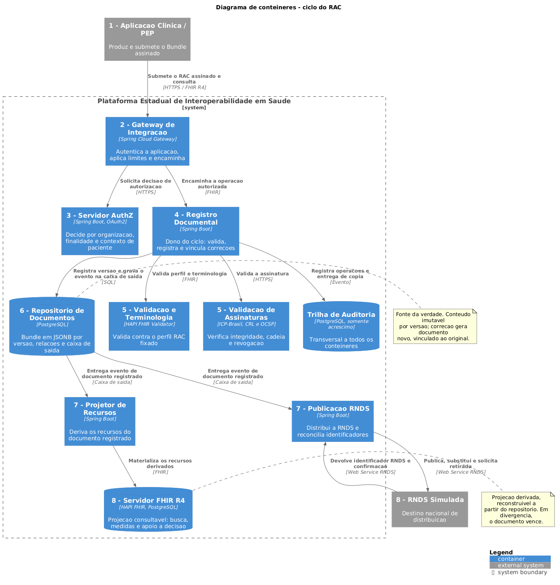
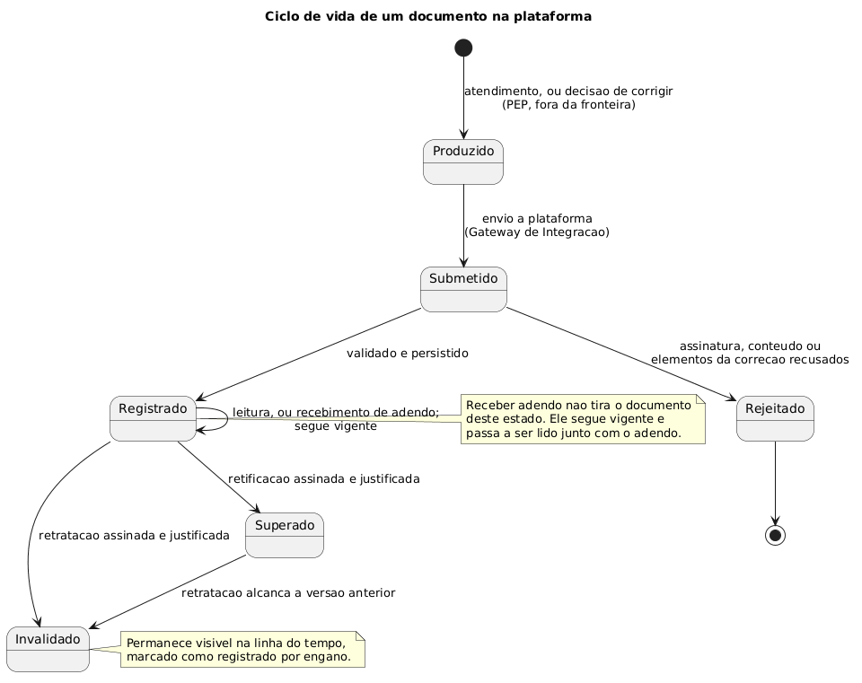

# Ciclo de vida do Registro de Atendimento Clínico

Proposta de arquitetura: a plataforma estadual mantém repositório próprio e é a fonte da verdade do documento. A RNDS deixa de ser onde o documento vive e passa a ser um destino de distribuição, alcançado de forma assíncrona.

## 1. O que muda

| Aspecto | Antes | Agora |
| --- | --- | --- |
| Onde o documento vive | Origem e RNDS | Origem, plataforma e RNDS |
| Quem responde por qual versão vigora | RNDS | Plataforma |
| Leitura | Proxy sobre a RNDS | Local, sem dependência externa |
| Momento em que a submissão é confirmada | Após aceitação pela RNDS | Após persistência local |
| Efeito de a RNDS cair | Leitura para | Distribuição atrasa; leitura segue |
| Dado clínico durável na plataforma | Nenhum | Todos os RACs registrados |

Três consequências diretas:

- Fonte da verdade local. A plataforma guarda cada versão do RAC e responde por qual vigora. Antes essa resposta exigia consultar a RNDS, única que sabia.
- Leitura sem dependência externa. A consulta é servida pelo repositório; nenhuma leitura depende de sistema fora da governança da equipe.
- Distribuição desacoplada. A confirmação ao PEP sai da persistência local; publicação e projeção consomem a caixa de saída depois disso.

## 2. Autoridade

Ser sistema de registro do documento não é ser autoridade sobre o seu conteúdo clínico. A separação abaixo é o que sustenta a custódia sem assumir responsabilidade assistencial.

| Papel | Quem exerce | Significado |
| --- | --- | --- |
| Autoria clínica | Profissional e estabelecimento do atendimento | Respondem pelo que o documento afirma; a autoria é registrada no próprio Bundle e é imutável |
| Responsabilidade pela correção | Profissional responsável pelo registro original, ou quem o suceda formalmente | Assina a retificação ou o adendo e responde pela justificativa |
| Custódia e sistema de registro | Plataforma estadual | Versiona, serve, mantém a linha do tempo e responde por qual versão vigora |
| Produção | Aplicação Clínica / PEP | Gera e submete; mantém cópia própria, que deixa de ser a referência para os demais participantes |
| Destino de distribuição | RNDS | Recebe cópia do que já foi registrado; não decide sobre o documento nem é consultada sobre qual versão vigora |

## 3. Contêineres

| Nº | Contêiner | Tecnologia | Responsabilidade |
| --- | --- | --- | --- |
| 1 | Aplicação Clínica / PEP | Sistema externo | Produz e submete o Bundle assinado |
| 2 | Gateway de Integração | Spring Cloud Gateway | Ponto único de entrada: autentica a aplicação, aplica limites e encaminha |
| 3 | Servidor AuthZ | Spring Boot, OAuth2 | Decide por organização, finalidade de uso e contexto de paciente |
| 4 | Registro Documental | Spring Boot | Dono do ciclo: encadeia validações, vincula correções e é o único que escreve no repositório |
| 5 | Validação e Terminologia | HAPI FHIR Validator | Valida contra o perfil RAC fixado e as terminologias controladas |
| 5 | Validação de Assinaturas | ICP-Brasil, CRL e OCSP | Verifica integridade, cadeia, revogação e carimbo de tempo |
| 6 | Repositório de Documentos | PostgreSQL | Fonte da verdade: Bundle em JSONB por versão, relações entre versões e caixa de saída |
| 7 | Projetor de Recursos | Spring Boot | Deriva os recursos do documento registrado |
| 7 | Publicação RNDS | Spring Boot | Distribui à RNDS e reconcilia identificadores |
| 8 | Servidor FHIR R4 | HAPI FHIR, PostgreSQL | Projeção consultável: busca, medidas e apoio à decisão |
| 8 | RNDS Simulada | Sistema externo | Destino nacional |
| — | Trilha de Auditoria | PostgreSQL, somente acréscimo | Transversal: registra operações, incluindo entrega de cópia |

Java, Spring Boot e HAPI FHIR são decisões fixadas no projeto. PostgreSQL e os demais produtos são proposta a ratificar, junto com as versões.

## 4. Os oito passos do registro

O caminho síncrono termina no passo 6. Os passos 7 e 8 são assíncronos e não atrasam a resposta ao PEP.

| Nº | Passo | Onde acontece | O que ocorre |
| --- | --- | --- | --- |
| 1 | Submissão | Aplicação Clínica / PEP | Produz o Bundle do atendimento, assina e submete com chave de idempotência e identificador de negócio |
| 2 | Autenticação | Gateway de Integração | Autentica a aplicação, aplica limites de taxa e encaminha; não carrega lógica de domínio |
| 3 | Autorização | Servidor AuthZ | Decide por organização, finalidade e contexto de paciente |
| 4 | Orquestração | Registro Documental | Assume a submissão autorizada, encadeia as validações e decide quando vira registro |
| 5 | Validação | Os dois serviços de validação, em paralelo | Perfil e terminologias de um lado; cadeia ICP-Brasil, CRL e OCSP do outro |
| 6 | Registro | Repositório de Documentos | Grava a versão em JSONB e o evento na caixa de saída, na mesma transação. A confirmação volta ao PEP aqui |
| 7 | Difusão | Projetor de Recursos e Publicação RNDS | Dois consumidores independentes da caixa de saída |
| 8 | Destinos | Servidor FHIR R4 e RNDS Simulada | A projeção fica consultável; a RNDS devolve o identificador nacional, correlacionado ao local |

A caixa de saída gravada na mesma transação do registro é o que garante que nenhum documento registrado deixe de ser projetado e enviado, mesmo que o processo caia logo após o commit.

## 5. Correção: adendo e retificação

O Bundle é imutável e assinado. Corrigir é registrar outro documento, com relação declarada ao original, em uma de duas vias.

| Via | Quando se aplica | Efeito sobre o original | O que a leitura entrega |
| --- | --- | --- | --- |
| Adendo | Informação que faltou, complemento posterior, esclarecimento | Segue vigente, no estado Registrado | Os dois documentos, como conjunto |
| Retificação | Erro que torna o conteúdo original incorreto | Passa a Superado | A versão vigente, mais a linha do tempo com acesso à anterior |

A escolha é clínica e cabe a quem assina. A plataforma exige que a via seja declarada e impede que uma seja usada no lugar da outra de forma silenciosa.

Elementos obrigatórios nas duas vias:

- referência ao documento e à versão corrigidos;
- via declarada: complementa ou substitui;
- justificativa textual da correção;
- instante da correção, distinto do instante do atendimento;
- assinatura do profissional responsável pela correção.

Faltando qualquer um, a submissão é recusada. Em nenhuma das vias uma versão anterior é apagada: ela permanece visível na linha do tempo do atendimento.

A leitura de um atendimento não devolve apenas a versão vigente. Devolve o documento vigente, os adendos anexados a ele e a linha do tempo com todas as versões, adendos e invalidações, cada um com instante, responsável e justificativa. A distinção importa: a regulação exige que o registro anterior continue visível, não apenas recuperável sob demanda.

## 6. Ciclo de vida do documento

Vale para qualquer documento registrado, inclusive para um adendo. Nenhum estado apaga o que veio antes.

| Estado | Significado | Transição de entrada |
| --- | --- | --- |
| Produzido | O PEP gerou o Bundle; a plataforma ainda não o recebeu | Evento assistencial, no sistema de origem |
| Submetido | Chegou à plataforma e aguarda verificação | Envio pelo PEP, recebido no Gateway |
| Rejeitado | Assinatura, conteúdo ou elementos obrigatórios da correção recusados; nada é registrado | Recusa em uma das validações do passo 5 |
| Registrado | Persistido e vigente. Receber adendo não tira o documento deste estado | Validações aprovadas e persistência concluída |
| Superado | Uma retificação registrou versão posterior; permanece acessível e visível na linha do tempo | Retificação assinada e justificada |
| Invalidado | Marcado como registrado por engano; permanece visível, identificado e com a justificativa | Retratação assinada pelo profissional responsável |

Invalidado não oculta. Decisões podem ter sido tomadas com base no documento, e suprimi-lo da leitura equivaleria a ocultar um registro. Exclusão física permanece possível apenas por determinação legal específica, como caso excepcional fora deste ciclo, com a remoção e seu fundamento registrados na trilha.

## 7. Distribuição

Segundo ciclo, independente do primeiro, mantido por destino. O documento já vigora localmente enquanto percorre estes estados, e nenhum deles bloqueia a leitura.

| Estado | Significado | Transição de entrada |
| --- | --- | --- |
| Pendente | Registrado localmente, aguardando publicação | Evento na caixa de saída, após o passo 6 |
| Publicado | A RNDS aceitou e emitiu identificador, correlacionado ao local | Aceitação pela RNDS |
| Divergente | A RNDS recusou um documento que a plataforma aceitou | Recusa pela RNDS |
| Retirado | A invalidação local foi propagada e confirmada | Propagação de uma invalidação |

## 8. Consequências da decisão

Reter documento clínico de forma durável muda o perfil de risco da plataforma. Estes pontos passam a ser obrigação.

| Consequência | O que exige |
| --- | --- |
| Base legal para a custódia | Guardar documento clínico produzido por terceiros exige fundamento jurídico, não apenas capacidade técnica |
| Política de retenção | A decisão cria retenção durável onde não havia; o prazo precisa ser fixado, não herdado por omissão |
| RPO e RTO definidos | Perder o repositório passa a significar perder a fonte da verdade; backup verificado por restauração periódica |
| SLO do repositório | O ponto único de falha saiu da RNDS e passou ao repositório próprio, agora sob governança, com réplica e dimensionamento da equipe |
| Modelo de ameaças revisado | Concentrar documentos clínicos de toda a UF aumenta o valor do alvo |
| Reconstrução da projeção | Se o Servidor FHIR divergir do repositório, o documento vence; a reconstrução precisa ser operação suportada e testada |
| Linha do tempo entregável | A trilha de correções faz parte do registro, não é log interno |
| Correção após entrega de cópia | O fornecimento de cópia é evento auditável, para que correções posteriores sejam detectáveis |

## 9. Decisões em aberto

| Questão | Por que importa |
| --- | --- |
| Política para o estado Divergente | A RNDS recusa um documento que a plataforma aceitou. Ele vigora localmente, pode ter sido lido e orientado conduta, e não existe nacionalmente. Manter e sinalizar preserva a autonomia estadual; reverter devolve a decisão à RNDS e contradiz a premissa de fonte da verdade local |
| Prazo de retenção do documento registrado | Precisa ser decidido antes de qualquer implantação com dado real, junto com a base legal da custódia |
| Adendo sobre documento retificado | O adendo complementava uma versão específica; a retificação precisa declarar se ele permanece válido ou se seu conteúdo foi absorvido |
| Alcance da projeção | Quais recursos do documento vigente e dos adendos são materializados no Servidor FHIR; o recorte define o que medidas CQL e apoio à decisão enxergam |

As duas primeiras precisam estar resolvidas antes de qualquer implantação que guarde dado real — o que, neste trabalho, não ocorre, já que todos os dados são sintéticos.
