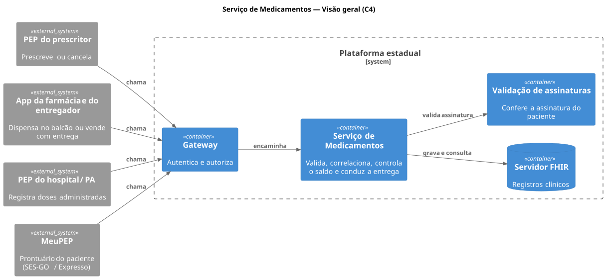
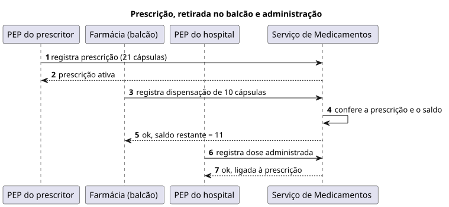
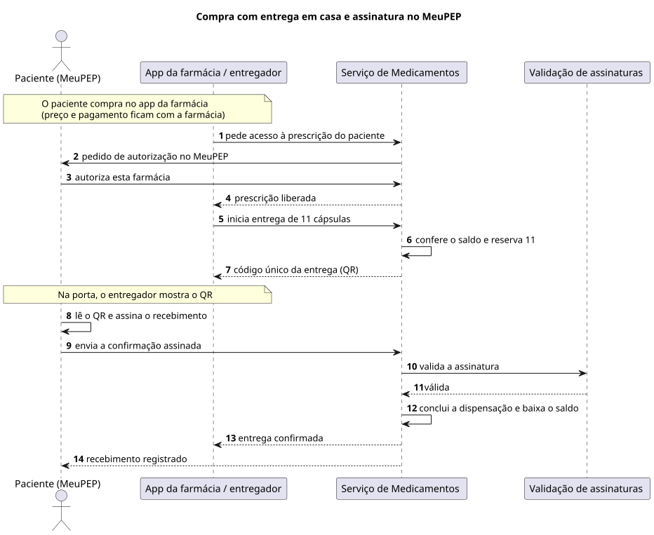
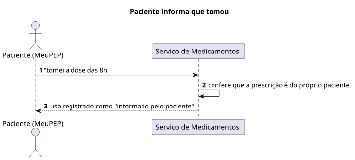
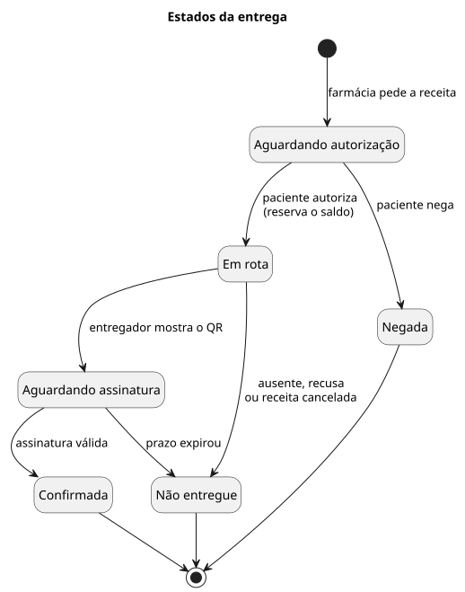

# Serviço de Medicamentos — Design v1

Autor: Guilherme Dutra · 04/11/2026

> **Status:** proposta para discussão da equipe, ainda não aprovada. O uso do
> MeuPEP / Expresso Goiás segue como alternativa em avaliação, conforme
> [AGENTS.md](../../AGENTS.md).

O serviço faz os registros de prescrição, dispensação e administração circularem entre os prestadores. Nesta versão ele também permite ao paciente confirmar no MeuPEP o recebimento de um medicamento entregue em casa e informar que o tomou.

> **Organização desta pasta**
>
> - `README.md` — este documento
> - `diagramas/puml/` — fontes PlantUML dos diagramas
> - `diagramas/svg/` — diagramas renderizados (gerados a partir dos `.puml`)

## 1. Contexto e escopo

O serviço **não prescreve, não vende e não entrega** medicamentos. Ele recebe os registros de cada ato, confere, liga uns aos outros e avisa os envolvidos.

**Quem participa**

- **Prescritor**, pelo PEP do estabelecimento: prescreve ou cancela.
- **Farmácia**, pelo seu sistema ou app (ex.: Drogasil): dispensa no balcão ou vende com entrega em casa. Preço, estoque e pagamento continuam com ela.
- **Entregador**, pelo app da farmácia: leva o medicamento e mostra o QR da entrega.
- **Enfermagem**, pelo PEP do hospital ou do pronto-atendimento: administra doses.
- **Paciente**, pelo **MeuPEP**, o prontuário do paciente da SES-GO, na plataforma Expresso:
  - autoriza a farmácia a usar a receita;
  - assina o recebimento;
  - informa que tomou o medicamento.

**Fora desta versão:** preço, pagamento, estoque, logística da entrega, receituário de controlados e dados reais.

## 2. Visão geral (C4)

Nenhum sistema fala direto com outro: todos passam pela plataforma. O MeuPEP e o app da farmácia não se conectam entre si.



<sub>Fonte: [`01-visao-geral.puml`](diagramas/puml/01-visao-geral.puml)</sub>

- **Gateway:** confere quem está chamando e se tem permissão.
- **Serviço de Medicamentos:** valida os registros, liga dispensação e administração à prescrição, controla o saldo da receita e conduz a entrega.
- **Servidor FHIR:** guarda os registros clínicos.
- **Validação de assinaturas:** confere a assinatura do paciente no recebimento.

## 3. Fluxos

Para simplificar, os diagramas omitem o Gateway. Toda chamada passa por ele antes de chegar ao serviço.

### 3.1 Prescrição, retirada no balcão e administração



<sub>Fonte: [`02-sequencia-balcao.puml`](diagramas/puml/02-sequencia-balcao.puml)</sub>

Uma retirada parcial não encerra a prescrição. A dose aplicada no hospital é um registro separado e não mexe no saldo.

### 3.2 Compra com entrega em casa e assinatura no MeuPEP



<sub>Fonte: [`03-sequencia-entrega-domicilio.puml`](diagramas/puml/03-sequencia-entrega-domicilio.puml)</sub>

Se a assinatura não for válida, nada é concluído. O código serve para uma única entrega; sozinho ele não confirma nada.

### 3.3 Paciente informa que tomou



<sub>Fonte: [`04-sequencia-uso-informado.puml`](diagramas/puml/04-sequencia-uso-informado.puml)</sub>

## 4. Estados da entrega



<sub>Fonte: [`05-estados-entrega.puml`](diagramas/puml/05-estados-entrega.puml)</sub>

- Só **Confirmada** conta como dispensação e baixa o saldo.
- **Não entregue** devolve a quantidade reservada ao saldo.

## 5. Decisões principais

| Decisão | Alternativa descartada | Por quê |
| --- | --- | --- |
| O pedido nasce no app da farmácia; o MeuPEP serve para autorizar, assinar e informar o uso | Pedir a entrega pelo MeuPEP | O MeuPEP teria de mostrar preço, estoque e pagamento, e isso não é papel de um prontuário |
| A farmácia só usa a receita depois que o paciente autoriza no MeuPEP | Farmácia buscar receitas livremente | A receita é dado de saúde; só o paciente libera |
| O recebimento é confirmado por assinatura digital no MeuPEP, sobre o código único da entrega | Código simples, como nos apps de farmácia | Um código pode ser repassado; a assinatura prova quem recebeu, qual entrega e quando |
| A dispensação com entrega só é concluída após a assinatura | Concluir quando o remédio sai da farmácia | Sem assinatura não há prova de que chegou |
| A quantidade da entrega fica reservada, e cada receita tem no máximo uma entrega em andamento | Só conferir o saldo no fim | Evita que alguém retire o mesmo remédio no balcão enquanto a entrega está a caminho |
| "Tomei o remédio" fica registrado como uso informado pelo paciente (`MedicationStatement`) | Registrar como administração (`MedicationAdministration`) | Administração é dose aplicada por profissional; misturar os dois confunde o histórico |

**Para uma próxima versão:** entrega por farmácias públicas do SUS (sem preço, pedida direto pelo MeuPEP), recebimento por um responsável e o que fazer quando o paciente não tem acesso ao MeuPEP.

## Como regenerar os diagramas

Com o [PlantUML](https://plantuml.com/) (versão com a biblioteca C4 embutida), a partir de `docs/servico-medicamentos/diagramas`:

```bash
java -jar plantuml.jar -charset UTF-8 -tsvg -o ../svg puml/*.puml
```
